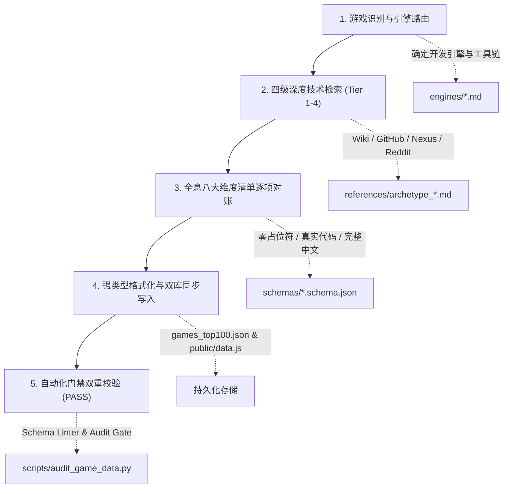

# Game Vault Enricher Skill (单机游戏作弊与Mod宝典工程化挖掘引擎 v2.5)

本 Skill 是 `L-MOD Vault` 针对 PC 单机游戏作弊控制台、物品生成数据库、修改器以及精选 Mod 的工业级数据挖掘与质检引擎。
核心目标：**彻底杜绝通用模板化、版本失效与严重缺漏，做到每款游戏 100% 针对当前补丁实测可用、零假指令占位符。**

---

## 🏗️ 模块化完整架构概览

```
.agent/skills/game-vault-enricher/
├── SKILL.md                          # [总控调度器] 自动分类、技术路由、数据采掘与门禁调度
├── schemas/                          # [强类型规范矩阵]
│   ├── game_command.schema.json      # 单条指令强类型字段 (id, name, syntax_type, code, desc, min_version, framework_required)
│   ├── game_full.schema.json         # 游戏全局条目主结构 (含 categories, trainerInfo, curatedMods, guides)
│   ├── trainer_info.schema.json      # FLiNG 修改器规范 (含 powershellExclusionCmd, hotkeysCategorized)
│   └── curated_mod.schema.json       # N网 Mod 规范 (真实作者/版本/下载量/依赖链/Steam分步安装)
├── references/                       # [7 大游戏原型规则库 (均含四级检索词与8大维度清单)]
│   ├── archetype_1_rpg_action.md     # 开放世界 RPG: 任务 Fact 标志位/Hex 物品 ID/载具生成
│   ├── archetype_2_soulslike_ue.md   # 魂系与虚幻引擎: UE4SS 注入/慢动作识破/精魄化身/EAC防作弊绕过
│   ├── archetype_3_survival.md       # 沙盒生存: 自由建造无消耗/实体生成/饥渴氧气锁死/坐标传送
│   ├── archetype_4_strategy_4x.md    # P社/4X战略: 国策瞬间完成/控制台Tag切换/瞬间科研/强制外交
│   ├── archetype_5_colony_auto.md    # 自动化与殖民: 科技树瞬间全开/无限电力/虫巢与污染清除
│   ├── archetype_6_roguelike.md      # 肉鸽卡牌: 卡组动态注入/全遗物祝福解锁/进阶等级直升
│   └── archetype_7_simulation.md     # 驾驶物理模拟: 自由飞行相机/车辆物理调校/违章罚单清除
├── engines/                          # [10 大核心引擎与框架注入规范]
│   ├── ue4ss_injection.md            # 虚幻4/5 引擎: RE-UE4SS 调试控制台与 BGUFunctionLibraryManaged Hook
│   ├── cet_lua_guide.md              # RED 引擎 4: Cyber Engine Tweaks 2.0+ Lua 接口 (2077)
│   ├── redengine3_witcher_guide.md   # RED 引擎 3: general.ini DBGConsoleOn 原生控制台与 WitcherScript (巫师3 次世代版 / 完全版)
│   ├── creation_engine.md            # Creation 引擎 (CE1/CE2): Bethesda 原生 ~ 控制台与 8位 Hex ID (天际/辐射/星空)
│   ├── fromsoftware_engine.md        # FromSoftware 专有引擎: EAC 离线绕过、ModEngine2 与 TGA Cheat Table (法环/魂3/只狼)
│   ├── reframework_guide.md          # 卡普空 RE 引擎: REFramework (dinput8.dll) 内存钩子与 FreeCam (生化4/村庄/龙信2)
│   ├── unity_bepinex_guide.md        # Unity 引擎: BepInEx 5/6 架构、-console devcommands 与内置 DevMode (帕鲁/英灵神殿/深海迷航)
│   ├── rockstar_rage_engine.md       # Rockstar RAGE 引擎: Script Hook V / RDR2, dinput8, 原生秘籍 (GTA5/荒野大镖客2)
│   ├── larian_divinity_engine.md     # 拉瑞安 Divinity 4.0: BG3 Script Extender (DWrite.dll) 与 Osiris Lua 控制台 (博德之门3)
│   └── clausewitz_engine.md          # P社 Clausewitz 引擎: -debug_mode 启动项与国家 Tag 体系 (钢4/群星/CK3)
└── scripts/
    └── validate_game.py              # [内部质检工具] 离线强类型 Schema 严格合规校验
```

---

## 🗺️ 引擎与原型快速路由表 (Engine & Archetype Routing Matrix)

| 目标游戏 | 推荐原型 | 对应引擎规范 | 核心唤出/注入方式 |
|---|---|---|---|
| **赛博朋克 2077** | `archetype_1_rpg_action` | `engines/cet_lua_guide.md` | CET Overlay (`~` 键唤出) |
| **黑神话：悟空** | `archetype_2_soulslike_ue` | `engines/ue4ss_injection.md` | RE-UE4SS (`F10` 键) + WukongGM (`F7` 键) |
| **巫师 3：狂猎 (次世代版)** | `archetype_1_rpg_action` | `engines/redengine3_witcher_guide.md` | `general.ini` 添加 `DBGConsoleOn=true` (`~` 键) |
| **博德之门 3** | `archetype_1_rpg_action` | `engines/larian_divinity_engine.md` | BG3 Script Extender (`DWrite.dll`) 控制台黑窗 |
| **艾尔登法环** | `archetype_2_soulslike_ue` | `engines/fromsoftware_engine.md` | EAC 离线替换引导 + TGA Cheat Table + ModEngine2 |
| **上古卷轴5 / 辐射4 / 星空** | `archetype_1_rpg_action` | `engines/creation_engine.md` | 原生 `~` 控制台 + 8位 Hex FormID |
| **幻兽帕鲁** | `archetype_3_survival` | `engines/ue4ss_injection.md` / `unity_bepinex_guide.md` | UE4SS 注入 + Palworld Save Tools |
| **GTA 5 / 荒野大镖客 2** | `archetype_1_rpg_action` | `engines/rockstar_rage_engine.md` | `ScriptHookV.dll` + `dinput8.dll` (`F4`/`F5` 菜单) |
| **生化危机4重制版 / 怪物猎人** | `archetype_1_rpg_action` | `engines/reframework_guide.md` | REFramework (`dinput8.dll`) (`Insert` 键开启 ImGui) |
| **英灵神殿 / 深海迷航** | `archetype_3_survival` | `engines/unity_bepinex_guide.md` | Steam 启动项 `-console` (`F5` 键) / `F3+F8` |
| **钢铁雄心4 / 群星 / CK3** | `archetype_4_strategy_4x` | `engines/clausewitz_engine.md` | Steam 启动项 `-debug_mode` (`~` 键) |
| **边缘世界 / 异星工厂** | `archetype_5_colony_auto` | `engines/unity_bepinex_guide.md` | 选项开启开发人员模式 (Dev Mode) / `/c` Lua 控制台 |
| **杀戮尖塔 / 小丑牌** | `archetype_6_roguelike` | `engines/unity_bepinex_guide.md` | ModTheSpire (BaseMod) / Steamodded |
| **欧洲卡车模拟 2** | `archetype_7_simulation` | `references/archetype_7_simulation.md` | `config.cfg` 启用 `uset g_developer "1"` (`0` 键 + `F9`) |

---

## 📋 工业级标准五步作业 SOP (Standard Operating Procedure)



### 第一步：游戏识别与引擎路由
1. 查询游戏所使用的游戏引擎与当前官方版本（如 UE5, REDengine 3, Unity, Creation Engine 2）；
2. 查阅 [engines/](file:///Users/xiaolu/Desktop/work/l-mod-portal/.agent/skills/game-vault-enricher/engines/) 确定其控制台/注入前置与按键唤出机制。

### 第二步：四级精准技术检索 (4-Tier Retrieval)
1. **Tier 1 (官方/开发者拆包数据)**：Fandom, UESP, ParadoxWikis, RedModding；
2. **Tier 2 (专有底层框架与 GitHub 库)**：UE4SS, CET, ModEngine2, BepInEx, Script Extenders；
3. **Tier 3 (Nexus Mods 权威专区)**：全周期 Downloads 与 Endorsements 倒排分析核心前置；
4. **Tier 4 (社区痛点排查)**：Reddit 专帖、Steam 指南，排查恶性卡关与版本失效旧代码。

### 第三步：八大系统维度全息对账
- [ ] 1. 核心生存与无敌/慢动作防反教学
- [ ] 2. 货币、负重、技能成长与洗点机制
- [ ] 3. 全套传奇/不朽神装与专属 Hex ID / Preset
- [ ] 4. 游戏特色专属机制（精魄、义体、龙吼、骨灰、战灰）
- [ ] 5. 载具/坐骑一键买断与独立召唤
- [ ] 6. 任务 Fact、隐藏结局与救赎机制
- [ ] 7. 昼夜时间流速、天气调控与拍照运镜
- [ ] 8. 内置迷你游戏（昆特牌/小丑牌）或全图鉴成就

### 第四步：双库同步持久化 (Dual Persistence)
1. 更新主数据源：`src/data/games_top100.json`
2. 同步前端离线数据库：`public/data.js`

### 第五步：自动化门禁双重校验 (PASS)
执行本地校验脚本，确保 100% 绿色通过：
```bash
# 1. 强类型 Schema 静态校验
python3 .agent/skills/game-vault-enricher/scripts/validate_game.py <game_id>

# 2. 引擎语法 Linter 与数量门禁
python3 scripts/audit_game_data.py <game_id>
```
两个命令必须全部输出 `✅ [PASS]` 方可完成交付！
