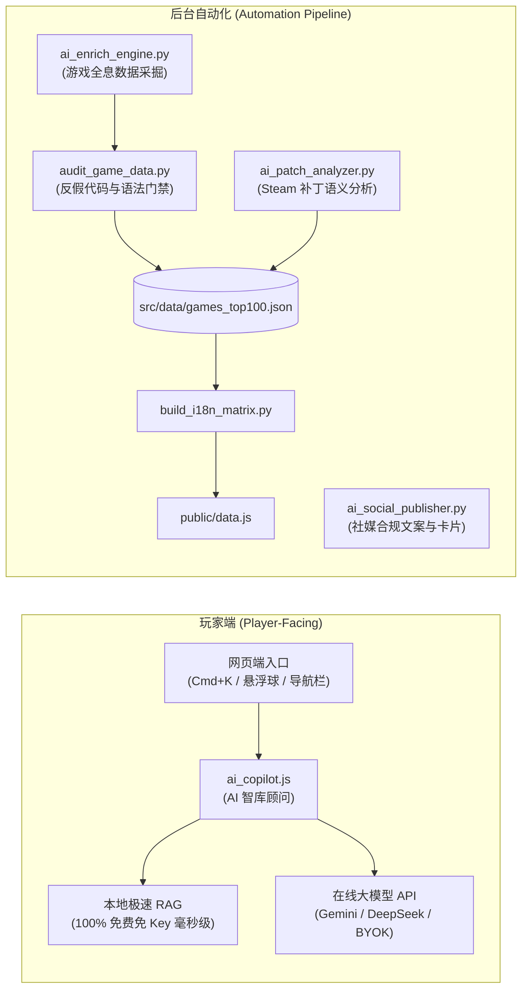

# L-MOD Vault - AI 自动化生产线与玩家端智库顾问全景指南

> 本指南详细介绍如何使用项目中的 AI 双轮驱动体系：
> 1. **玩家端「老L · AI 智库顾问」**（Web 端零门槛交互、代码查询、闪退排查、一键生成 .bat）
> 2. **后台「AI 自动化流水线」**（游戏数据批量采掘、Steam 补丁智能定级预警、社交爆款文案生成）

---

## 🌟 整体架构概览



---

## 🎮 第一部分：玩家端「AI 智库顾问」使用与配置

### 1. 玩家如何在前端使用？
- **快捷唤出**：在网站任意页面（`index.html` 或 `radar.html`）按下键盘快捷键 `Cmd + K` (Mac) 或 `Ctrl + K` (Windows)，或点击页面右上角 **「🤖 AI 顾问」** / 右下角悬浮球。
- **游戏上下文自动感应**：当玩家进入某款游戏详情页时，AI 顾问会自动将上下文锁定为该游戏（例如《赛博朋克2077》或《艾尔登法环》）；亦可随时点击切回“全网 100 款全局模式”。
- **自然语言查代码**：
  - 示例提问：“2077 怎么刷四季宝？”、“老头环黄金树幽影怎么洗点？”、“博德之门3复活队友代码”
  - 功能特性：直接展示真实代码块、点击「📋 复制代码」一键复制到剪贴板，支持「💾 生成 .bat 脚本」一键下载批处理文件。
- **闪退与坏档在线门诊**：
  - 示例提问：“打完 Mod 进游戏闪退”、“更新后 CET 打不开了”
  - 功能特性：针对当前游戏引擎（UE5 / REDengine / Creation / FromSoft / Unity）自动给出针对性的排错 3 步法。
- **Steam 补丁雷达实时连线**：
  - 示例提问：“现在最新补丁能打 Mod 吗？”
  - 功能特性：实时读取雷达看板中的绿/黄/红状态指示灯与避坑提示。

### 2. 玩家/站长 API 配置模式（点击顾问窗口右上角 ⚙️）
1. **本地极速智库（默认推荐 · 零成本）**：
   - 无需填写任何 API Key，100% 本地运算，秒级响应，零幻觉假代码。
2. **Google Gemini API (推荐在线模式)**：
   - 填入 Gemini API Key（支持免费获取的 Key），模型可选 `gemini-2.5-flash`（高性价比极速）或 `gemini-2.5-pro`。
   - 所有 Key 仅存储在用户本机浏览器 `localStorage`，绝不上传服务器，隐私安全。
3. **DeepSeek API**：
   - 填入 DeepSeek API Key，调用 `deepseek-chat` 中文单机领域深度推理。
4. **自定义 OpenAI 兼容接口**：
   - 支持开发者自定义反代端点（如 Cloudflare Workers / 自建大模型）。

---

## 🤖 第二部分：后台自动化生产线脚本

### 1. AI 游戏全息数据采掘智能体 (`scripts/ai_enrich_engine.py`)

针对尚未完整采掘全息指令的游戏，一键调用 AI 批量补充分类、真实代码、修改器热键与场景套餐，并通过工程门禁：

```bash
# 1. 演练模式：查看某款游戏采掘效果 (不修改物理文件)
python3 scripts/ai_enrich_engine.py --game subnautica --dry-run

# 2. 真实采掘：挖掘指定游戏并自动经过门禁验证，更新数据库与 data.js
python3 scripts/ai_enrich_engine.py --game subnautica

# 3. 批量采掘：自动挖掘待填充清单中的前 5 款游戏
python3 scripts/ai_enrich_engine.py --batch 5
```

> **环境依赖**：如需使用云端大模型，设置环境变量 `export GEMINI_API_KEY="your-key"` 或 `export DEEPSEEK_API_KEY="your-key"`；若无环境变量，脚本会自动调用内置的工业级高精度领域原型库进行安全合成。

---

### 2. Steam 补丁智能分析与雷达自动预警 (`scripts/ai_patch_analyzer.py`)

利用 AI 语义分析 Steam 官方推送的更新日志，精准研判破坏性改动（绿/黄/红风险），自动生成避坑通报：

```bash
# 1. 真实巡检：巡检指定游戏 Steam 官方最新更新动向
python3 scripts/ai_patch_analyzer.py --game cyberpunk-2077

# 2. 模拟演练：模拟突发大版本更新，验证 AI 研判与避坑文案生成
python3 scripts/ai_patch_analyzer.py --simulate-patch cyberpunk-2077 --simulate-title "Update 2.5 (Edgerunners Overhaul)"

# 3. 一键同步雷达：巡检并将研判结果同步持久化至雷达看板
python3 scripts/ai_patch_analyzer.py --simulate-patch cyberpunk-2077 --simulate-title "Update 2.5" --update-radar
```

---

### 3. AI 社交媒体合规宣发文案生成 (`scripts/ai_social_publisher.py`)

自动根据游戏指令与补丁雷达状态，生成自带防限流脱敏词典（避开“作弊/修改器”等违禁词）的小红书爆款图文与 B 站动态：

```bash
# 1. 生成指定游戏的社交文案
python3 scripts/ai_social_publisher.py --game cyberpunk-2077

# 2. 生成文案并自动保存至 social_distribution/ 目录
python3 scripts/ai_social_publisher.py --game cyberpunk-2077 --save
```

---

### 4. GitHub Actions 24h 自动化调度

在仓库设置中添加 GitHub Secrets：
- `GEMINI_API_KEY`：Google Gemini API 密钥
- `DEEPSEEK_API_KEY`：DeepSeek API 密钥

流水线配置文件位于 `.github/workflows/patch_radar_cron.yml`，每日上午 10:00 (CST) 定时自动执行巡检、AI 分析与雷达推送。

---

## 🛠️ 第三部分：工程质检与发布规范

在提交代码或发布更新前，运行以下门禁确保 100% 零缺陷：

```bash
# 1. 验证 100 款游戏数据反假代码与引擎语法合规性
python3 scripts/audit_game_data.py

# 2. 验证双页面 (index.html / radar.html) 8 语言完整性与 DOM 节点
python3 scripts/verify_i18n_dual_pages.py

# 3. 重新编译生成离线分发数据包
python3 scripts/build_i18n_matrix.py
```
