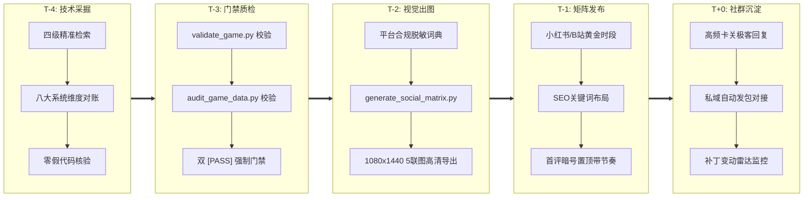

# L-MOD Vault 游戏采掘与内容生产五步作业流水线 SOP (Pipeline SOP)

> **版本**：v3.0 (Milestone 3 工业级标准落地版)  
> **制定部门**：L-MOD Vault 数据挖掘与极客运营工程组  
> **执行口径**：每款新收录游戏从立项挖掘到上线发布全生命周期必须严格执行五步闭环，严禁跨门禁推进！

---

## 🎯 流水线全景作业看板 (Timeline & Gateways)



---

## 步骤一：技术采掘 (T-4 节点 · 深度反编译与全息对账)

### 1.1 核心目标
建立对目标游戏引擎与版本底层机理的绝对认知，通过权威四级检索挖掘全部可用调试接口，落实 8 大系统维度，彻底杜绝通用模板化假指令与占位符。

### 1.2 四级精准检索工作流 (4-Tier Retrieval)
1. **Tier 1 (官方/开发者拆包数据源)**：
   - 优先查阅官方/社区逆向 Wiki（如 UESP、The Vault Fallout Wiki、Fandom 魂系数据库、RedModding、ParadoxWikis）；
   - 获取内部原生 FormID、Lua 函数签名、Papyrus 脚本名与事件标志位。
2. **Tier 2 (专有底层框架与 GitHub 核心库)**：
   - 查阅各引擎前置官方仓库（UE4SS、Cyber Engine Tweaks、SKSE64、F4SE、ModEngine2、REFramework、BepInEx）；
   - 确认当前官方最新补丁是否引发偏移量失效，锁定对应兼容框架版本。
3. **Tier 3 (Nexus Mods 权威专区分析)**：
   - 按照 **Downloads** 与 **Endorsements** 进行全周期与 30 天倒排；
   - 提炼排名前 10 的前置必备补丁（如 Engine Fixes、Crash Logger、SkyUI），杜绝推荐年久失修弃坑 Mod。
4. **Tier 4 (社区痛点排查与死循环 Bug 梳理)**：
   - 检索 Reddit `r/skyrimmods`、`r/eldenring` 与 Steam 讨论区高频求助贴；
   - 归纳 3~5 个因原版任务触发器损坏导致的死循环坏档卡关点，提取对应 `setstage` 或 Fact 代码。

### 1.3 八大系统维度硬性对账清单 (Checklist)
每款游戏入库必须 100% 覆盖以下八大维度：
- [ ] **维度 1：核心生存与状态锁死** (无敌模式、锁血不死、无限法力/精力、全局慢动作识破)；
- [ ] **维度 2：货币、负重、技能成长与洗点** (货币注入、背包负重解限、技能满级、免材料重铸)；
- [ ] **维度 3：官方最新大型 DLC 专属机制** (如黄金树幽影庇护点数、往日之影遗物点数、远港聚落)；
- [ ] **维度 4：全套传奇/不朽毕业神装** (全追忆武器、16大魔神器、X-01动力装甲、专属 Hex ID)；
- [ ] **维度 5：专属特色机制** (骨灰/战灰、传奇词条附魔、义体过载、龙吼铭文)；
- [ ] **维度 6：恶性死循环任务急救与 NPC 救赎** (任务强制跳转 stage、误杀 NPC 绝对赎罪复活)；
- [ ] **维度 7：专属建造/坐骑/特权直装** (聚落建造空间无限解除、炉火建材直装、灵马复活)；
- [ ] **维度 8：场景探索、全地图地标与摄影运镜** (全图赐福/地标一秒点亮、开发者房间传送、360°自由运镜)。

---

## 步骤二：门禁质检 (T-3 节点 · 强类型与语法 Linter 双重把关)

### 2.1 核心目标
数据持久化后，执行本地自动化双重门禁质检，不放过任何一个格式缺陷与语法伪指令，**必须双 `[PASS]` 方可流转至下一步**。

### 2.2 双重门禁执行标准
在本地终端执行以下质检命令：

```bash
# 门禁 1：强类型 Schema 静态严苛校验
python3 scripts/validate_game.py <game_id>

# 门禁 2：引擎语法 Linter 与规模门禁
python3 scripts/audit_game_data.py <game_id>

# 或一键执行流水线全链路自检调度器
python3 scripts/pipeline_gate.py <game_id>
```

### 2.3 验收标准细则
1. **Schema 校验规范**：
   - `game_full.schema.json`、`game_command.schema.json`、`trainer_info.schema.json`、`curated_mod.schema.json` 零字段缺失；
   - 指令必须包含合规的 `id`、双语名称（`zh-CN`, `en`）、`syntax_type`、真实可执行 `code`、详细 `desc`（长度 ≥ 5 字符）、`min_version`、`framework_required`；
   - 修改器必须包含 `author`、`version`、官方 `flingtrainer.com` 直连地址、`cleanMirrorUrl`、`powershellExclusionCmd` 与分类热键；
   - 精选 Mod 必须包含下载量、大小、真实作者、依赖链与清晰的分步安装步骤（不少于 2 步）。
2. **语法与规模门禁**：
   - Top 10 核心大作：分类数 ≥ 8，指令总数 ≥ 40 条；
   - Top 30 热门单机：分类数 ≥ 4，指令总数 ≥ 15 条；
   - 严禁出现 `god`, `addmoney`, `noclip` 等无对应引擎支持的通用假占位符；
   - 语法严格符合对应引擎规则（Creation 引擎 FormID/指令、FromSoftware 热键与 CT 规范、CET Lua、UE4SS GM 命令、WitcherScript 等）。

---

## 步骤三：视觉出图 (T-2 节点 · 合规脱敏与 5 联图卡片渲染)

### 3.1 核心目标
将技术采掘产出的高价值数据，通过合规脱敏引擎转化为适合小红书/B站传播的高清视觉卡片与文案包，构建专业避坑极客视觉壁垒。

### 3.2 合规脱敏引擎 (Anti-Shadowban)
出图与文案必须全程流经脱敏词典，严防平台违规限流：
- ❌ 作弊/外挂 ➔ ✅ **官方调试指令 / 底层控制台彩蛋**
- ❌ 修改器 ➔ ✅ **纯净优化拓展包 / 开源调试框架**
- ❌ 锁血/无敌 ➔ ✅ **手残救星·剧情体验模式 / 绝对防护**
- ❌ 刷钱/无限金币 ➔ ✅ **资源自由·全图鉴解锁 / 经济充裕**
- ❌ 穿墙/飞天 ➔ ✅ **自由摄影·全景透视视角**
- ❌ 微信/加群 ➔ ✅ **后台回复暗号 / 主页自取**

### 3.3 自动化出图作业
```bash
# 1. 生成社交矩阵数据与脱敏多平台文案
python3 scripts/generate_social_matrix.py <game_id>

# 2. 批量渲染 1080x1440 3:4 比例高清 5 联图
python3 scripts/render_cards_png.py <game_id>
```

#### 5 联图标准结构
- **Card 1 (黄金爆款封面)**：痛点大标题 + 游戏高清名片 + 官方最新补丁实测印章 + 老L避坑人设标；
- **Card 2 (小白避坑与环境配置)**：前置框架一键配置 + 零报毒信赖交付 + PowerShell 防误杀一键白名单；
- **Card 3 (核心场景套餐 A)**：手残救星 / 战斗减负 / 剧情体验模式代码组合；
- **Card 4 (核心场景套餐 B)**：全套毕业神装 / 稀缺资源 / 恶性卡关修复代码表；
- **Card 5 (行动召唤与自取通道)**：引导评论区暗号 / 私域离线包自取指引。

---

## 步骤四：矩阵发布 (T-1 节点 · 黄金时段与 SEO 精准卡位)

### 4.1 核心目标
抓取单机游戏核心玩家与上班族下班后的黄金流量时段，通过高权重 SEO 词条布局与第一条置顶评论锁定转化。

### 4.2 平台梯次发布时间表
| 平台 | 推荐发布时段 | 内容载体 | 核心重点 |
|---|---|---|---|
| **小红书** | **18:30 - 19:30** 或 **21:30 - 22:30** | 5 联图图文笔记 | 视觉冲击首图、800字痛点文案、标签群 |
| **B站动态/专栏** | **19:00 - 20:30** | 动态长图 + 专栏图文 | 极客专业人设、版本雷达避坑长文、置顶暗号 |
| **知乎想法/回答** | **12:00 - 13:00** (午休) | 专业问答贴 | 结合“如何评价该游戏/卡关怎么办”长文引流 |

### 4.3 SEO 搜索词与标签埋设规范
每篇发布内容必须包含三级标签阵列：
1. **核心游戏词**：`#艾尔登法环` `#上古卷轴5` `#辐射4` `#单机游戏`；
2. **场景痛点词**：`#新手救星` `#卡关抢救` `#画质优化` `#控制台代码` `#避坑指南`；
3. **品牌长尾词**：`#LMOD智库` `#老L单机秘籍` `#纯净单机`。

---

## 步骤五：社群沉淀 (T+0 节点 · 首评置顶与雷达监控)

### 5.1 核心目标
首评置顶承接公域流量，平稳导流至私域，建立长期玩家黏性与版本热更新信赖。

### 5.2 首评置顶与带节奏 SOP
笔记或动态发出后 **5 分钟内**，运营人员必须在评论区发布并置顶标准化话术：
> **首评置顶模版**：  
> 看到很多兄弟在问批处理脚本和完整 40+ 条指令怎么拿：  
> 老L已经把「双击一键开门脚本 + 官方纯净离线框架 + 场景代码合集 TXT」打包成免配一键包了！  
> 👉 **直接看我主页介绍，或者在后台回复暗号：【老L单机888】或对应的游戏名（如【法环】、【天际】、【辐射4】）**，系统就会秒推高速链接。  
> ⚠️ 友情提示：所有文件均经过老L本地实机测试，零捆绑零木马，后续如果 Steam 推新大补丁我也会连夜更新，大家先点赞收藏防失效！

### 5.3 补丁变动雷达监控 (Patch Radar)
- 开启 SteamDB 与 Steam 官方公告 RSS 订阅；
- 一旦监测到目标游戏推送小更新导致框架失效，立即触发 **“雷达紧急响应机制”**：
  1. 在旧笔记置顶评论更新【版本雷达声明】；
  2. 针对受影响前置（如 F4SE、SKSE、CET），拉取开发者最新分支编译包；
  3. 更新私域网盘的一键包，实现零断档维稳服务。
