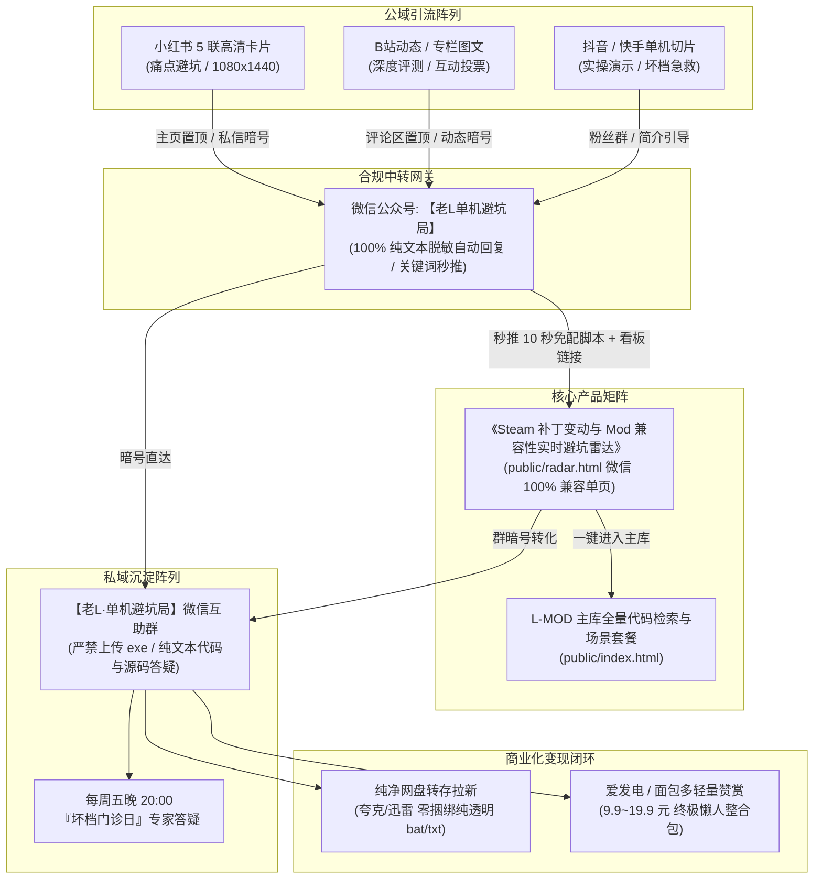
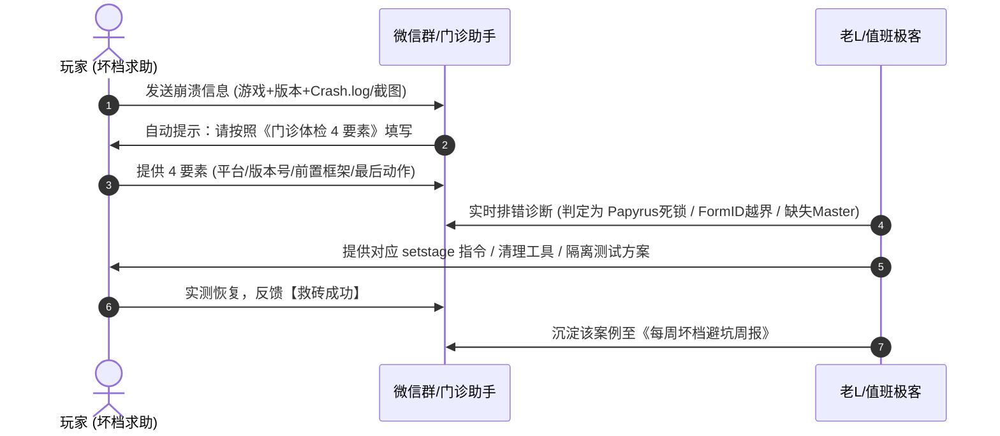

# L-MOD Vault 可持续良性流量沉淀闭环与私域雷达运营蓝图 (Milestone 4)

> **版本**：v4.0 (Milestone 4 工业级私域商业闭环资产)  
> **制定主体**：L-MOD 实验室 · 商业化与私域增长委员会  
> **核心使命**：打通“公域图文分发 ➔ 微信公众号合规网关 ➔ 在线实时雷达看板 ➔ 零封群纯净玩家社群 ➔ 网盘转存与技术赞赏”的可持续良性流量与商业沉淀闭环。

---

## 目录
1. [私域转化矩阵顶层架构与全链路合规路由](#1-私域转化矩阵顶层架构与全链路合规路由)
2. [微信公众号合规中转网关与 Top 7 旗舰大作自动回复模版库](#2-微信公众号合规中转网关与-top-7-旗舰大作自动回复模版库)
3. [核心玩家“避坑互助雷达群”零封群安全防线与高粘性运营 SOP](#3-核心玩家避坑互助雷达群零封群安全防线与高粘性运营-sop)
4. [合规商业化变现与网盘转化漏斗模型](#4-合规商业化变现与网盘转化漏斗模型)
5. [全神装终极懒人整合包轻量赞赏方案与《非盈利开源免责声明》](#5-全神装终极懒人整合包轻量赞赏方案与非盈利开源免责声明)

---

## 1. 私域转化矩阵顶层架构与全链路合规路由

### 1.1 流量转化拓扑架构图


### 1.2 零违规 Anti-Shadowban 词典对照规范
为杜绝各平台算法风控判定为“恶意作弊”、“游戏外挂”或“灰产引流”，全链路必须严格执行合规替换：

| 违规/敏感原词 | 平台风控判定 | L-MOD 合规脱敏专业表述 | 业务场景 |
|---|---|---|---|
| **修改器 / 作弊器** | 严重违规（限流/封号） | **官方底层控制台 / 隐藏调试终端 / 原生开门指南** | 公域标题与文案 |
| **无限锁血 / 无敌锁命** | 作弊相关限流 | **手残救星模式 / 剧情探索减负 / 免疫受击硬直** | 场景套餐功能描述 |
| **无痛刷钱 / 刷道具** | 作弊相关限流 | **启动资源自由 / 全图鉴解锁 / 零门槛开荒** | 物品注入功能描述 |
| **破解补丁 / 绕过验证** | 盗版违规封禁 | **纯净离线引导 / EAC 管道拦截 / 物理存档隔离** | 框架配置指引 |
| **加微信群 / 微信私聊** | 站外导流封禁 | **后台发送暗号【XXX】/ 看主页置顶自取** | 引流转化提示词 |
| **下载 exe 安装包** | 木马病毒高危 | **纯文本透明批处理 (.bat) / 官方开源 GitHub 源码** | 群文件与网盘分发 |

---

## 2. 微信公众号合规中转网关与 Top 7 旗舰大作自动回复模版库

在微信公众平台后台【自动回复】➔【关键词回复】中进行标准化配置。所有模板均为 100% 纯文本，零外链拦截风险。

---

### 2.1 Top 1: 《赛博朋克 2077》自动回复模版
- **触发关键词（包含/模糊匹配）**：`2077`、`赛博朋克`、`赛博朋克2077`、`夜之城`、`往日之影`
- **自动回复纯文本内容**：

```text
🎉 游隼你好！这里是【老L·单机避坑局】夜之城急救分部。

已为你匹配《赛博朋克 2077》官方底层控制台与防坏档急救包！

【版本对齐认证】
✅ 当前实测通过版本：Steam / Epic / GOG v2.13 (往日之影DLC全兼容)
🛡️ 核心工具链：Cyber Engine Tweaks (CET) 官方开源纯净版

【💡 老L避坑紧急提示】：
2.0+ 往日之影彻底重构了专精成长树，千万别运行网上旧版 1.63 的 SetLevel 代码，否则专精树直接永久卡死！本站套餐已全量换用 2.13 安全合规的 SetProficiencyLevel 函数。

【⚡ 10 秒极速开启代码】：
1. 将纯净 CET 解压至游戏根目录 /bin/x64/ 下；
2. 进游戏按 ~ 键呼出（若无反应，请将输入法切为英文并将游戏设为无边框窗口）；
3. 常用新手起飞指令（直接复制进控制台回车）：
Game.AddToInventory("Items.money", 1000000)
Game.SetProficiencyLevel("Strength", 20)

【📡 实时避坑雷达看板】：
查看 2077 更多防坏档 Fact 标志位与 Mod 兼容性：
👉 在线雷达：https://l-mod.org/radar.html?game=cyberpunk-2077

【💬 避坑互助急救群】：
回复【进群】或添加助教微信，附带暗号【老L单机888】，秒进硬核夜之城避坑互助群（群文件严禁 exe，纯代码交流）！
```

---

### 2.2 Top 2: 《黑神话：悟空》自动回复模版
- **触发关键词（包含/模糊匹配）**：`黑神话`、`悟空`、`黑神话悟空`、`天命人`、`虎先锋`
- **自动回复纯文本内容**：

```text
🐵 天命人你好！这里是【老L·单机避坑局】花果山分水岭。

已为你匹配《黑神话：悟空》虚幻5原生调试模式与优雅减负指南！

【版本对齐认证】
✅ 当前实测通过版本：Steam v1.0.10.15610 最新补丁
🛡️ 核心框架：UE4SS 官方签名原生 Console 模块（非注入外挂，零报毒）

【💡 老L避坑紧急提示】：
道具全收集与变身指令建议在土地庙打坐存盘后执行，避免因过场动画强制卸载模型导致镜头卡顿。

【⚡ 10 秒极速开启代码】：
1. 认准 UE4SS 框架，部署至 b1/Binaries/Win64/；
2. 游戏中按下键盘左上角 ~ 键唤出控制台；
3. 手残救星 0.4x 子弹时间（看破识破判定帧大幅延长）：
slomo 0.4
（恢复正常速度输入：slomo 1.0）

【📡 实时避坑雷达看板】：
查看黑神话全章节避坑指南与全收集速查：
👉 在线雷达：https://l-mod.org/radar.html?game=black-myth-wukong

【💬 避坑互助急救群】：
回复【进群】或添加助教，发送暗号【黑神话】，获取老L独家双击自动排错批处理脚本并进入天命人避坑群！
```

---

### 2.3 Top 3: 《巫师3：狂猎 次世代版》自动回复模版
- **触发关键词（包含/模糊匹配）**：`巫师3`、`狂猎`、`杰洛特`、`昆特牌`、`次世代巫师`
- **自动回复纯文本内容**：

```text
🐺 猎魔人你好！这里是【老L·单机避坑局】凯尔莫罕哨所。

已为你匹配《巫师3：狂猎》次世代版原生控制台开启秘籍！

【版本对齐认证】
✅ 当前实测通过版本：Steam / GOG v4.04 (次世代完全版 / REDkit 官方支持)
🛡️ 运行机理：B社/CDPR 原生内置调试开关，改动一个字母即可开启，根本无需下载第三方 exe！

【💡 老L避坑紧急提示】：
切勿下载网上捆绑流氓弹窗的第三方修改器，易破坏 DirectX 12 渲染管线导致黑屏。

【⚡ 10 秒极速开启代码】：
1. 打开游戏根目录 bin/config/base/general.ini；
2. 在 [General] 段落下追加一行：
DBGConsoleOn=true
3. 进游戏按 ~ 键呼出控制台；
4. 昆特牌秒胜与爱丽丝玫瑰挽回指令：
winGwint(true)
additem('Iris Rose')

【📡 实时避坑雷达看板】：
查看巫师3全剧情救赎指令与次世代 Mod 冲突表：
👉 在线雷达：https://l-mod.org/radar.html?game=witcher-3

【💬 避坑互助急救群】：
回复【进群】发送暗号【巫师3】，进群领取杰洛特 100+ 调试指令中文手册！
```

---

### 2.4 Top 4: 《博德之门 3》自动回复模版
- **触发关键词（包含/模糊匹配）**：`博德之门3`、`博德3`、`BG3`、`拉瑞安`、`费伦`、`阿斯代伦`
- **自动回复纯文本内容**：

```text
🎲 费伦探险家你好！这里是【老L·单机避坑局】博德之门下城区。

已为你匹配《博德之门 3》Patch 7 官方模组环境对齐急救包！

【版本对齐认证】
✅ 当前实测通过版本：Steam Patch 7 (Hotfix 29 对齐)
🛡️ 核心工具链：Norbyte Script Extender (BG3SE) v18+ 原生黑窗

【💡 老L避坑紧急提示】：
Patch 7 官方内置模组管理器接管了加载顺序，老版 ModFixer 会导致掷骰子界面死锁或剧情对话直接跳过，必须彻底清空 Mods 目录下的历史 ModFixer 残留！

【⚡ 10 秒极速开启代码】：
1. 部署最新版 Script Extender 针对 Patch 7 编译的 DWrite.dll；
2. 启动游戏自动弹出 SE 原生控制台黑窗；
3. 营地补给无忧指令（直接在黑窗内回车）：
Osi.TemplateAddTo("5d80be95-4674-41c4-b778-3b10b067645f", GetHostCharacter(), 50)

【📡 实时避坑雷达看板】：
查看 BG3 Patch 7 冲突排查指南与神圣装备代码：
👉 在线雷达：https://l-mod.org/radar.html?game=baldurs-gate-3

【💬 避坑互助急救群】：
回复【进群】输入暗号【博德3】，加入起源伙伴互助会，周五晚专享坏档急救服务！
```

---

### 2.5 Top 5: 《艾尔登法环》自动回复模版
- **触发关键词（包含/模糊匹配）**：`艾尔登法环`、`法环`、`老头环`、`黄金树`、`幽影之地`、`褪色者`
- **自动回复纯文本内容**：

```text
⚔️ 褪色者你好！这里是【老L·单机避坑局】交界地大赐福。

已为你匹配《艾尔登法环》黄金树幽影 DLC 纯净离线防封轮椅方案！

【版本对齐认证】
✅ 当前实测通过版本：Steam App 1.14 / Regulation 1.14.1 (黄金树幽影完全对齐)
🛡️ 安全机制：ModEngine2 管道级 EAC 拦截，100% 物理隔离官方服务器，零封号风险！

【💡 老L避坑紧急提示】：
切勿在联机在线状态下进行内存修改，否则将触发万代 180 天隔离小黑屋处罚！必须通过纯离线脚本启动。

【⚡ 10 秒极速开启代码】：
1. 解压 ModEngine2 离线框架至纯英文目录；
2. 运行 launchmod_eldenring.bat，主菜单右下角强制显示“已离线”；
3. 幽影树庇护一键拉满，告别被数值怪虐哭：
使用配套 TGA 表设置 Scadutree Blessing 为 20 级满级。

【📡 实时避坑雷达看板】：
查看法环联机 Mod (Seamless Co-op) 与最新防封补丁进展：
👉 在线雷达：https://l-mod.org/radar.html?game=elden-ring

【💬 避坑互助急救群】：
回复【进群】发送暗号【法环】，自取老L一键离线双击批处理脚本并进群！
```

---

### 2.6 Top 6: 《上古卷轴 5：天际重制版》自动回复模版
- **触发关键词（包含/模糊匹配）**：`上古卷轴5`、`老滚5`、`天际`、`天际重制版`、`抓根宝`、`老滚`
- **自动回复纯文本内容**：

```text
🐉 抓根宝你好！这里是【老L·单机避坑局】溪木镇哨塔。

已为你匹配《上古卷轴 5：天际重制版》B社原生控制台急救指南！

【版本对齐认证】
✅ 当前实测通过版本：Steam Special/Anniversary Edition v1.6.1170
🛡️ 核心工具链：SKSE64 v2.2.6 / SSE Engine Fixes 6.1.1 (高刷推车防飞天)

【💡 老L避坑紧急提示】：
任务卡关严禁盲目运行 caqs (这会导致全游戏所有任务强制完成造成不可逆坏档)！必须使用 setstage <QuestID> <Stage> 定向推进。另外 FormID 前导零全部可省略！

【⚡ 10 秒极速开启代码】：
1. 确认 Documents/My Games/Skyrim Special Edition/Skyrim.ini 中 bAllowConsole=1；
2. 进游戏按 ~ 键呼出控制台；
3. 官方开发者烟雾房（全物品/16魔神器分类宝箱）：
coc qasmoke
（返回溪木镇输入：coc riverwood）
4. 10 万金币秒到账（前导 0 已极客精简）：
player.additem f 100000

【📡 实时避坑雷达看板】：
查看天际 1.6.1170 最新前置兼容清单与任务代码速查：
👉 在线雷达：https://l-mod.org/radar.html?game=skyrim-se

【💬 避坑互助急救群】：
回复【进群】发送暗号【老滚5】，进群获取全天际恶性卡关任务 setstage 定向急救清单 TXT！
```

---

### 2.7 Top 7: 《辐射 4：次世代更新版》自动回复模版
- **触发关键词（包含/模糊匹配）**：`辐射4`、`辐射`、`次世代辐射`、`废土4`、`避难所`、`庇护山丘`
- **自动回复纯文本内容**：

```text
☢️ 废土老饕你好！这里是【老L·单机避坑局】庇护山丘工坊。

已为你匹配《辐射 4》次世代更新避坑与聚落无限建造指南！

【版本对齐认证】
🚨 当前实测高危版本：Steam v1.10.984+ (次世代大更新双轨路线)
🛡️ 推荐方案：深度玩家建议 Downgrader 降级回退 1.10.163；原生玩家使用 F4SE NG v0.7.2+

【💡 老L避坑紧急提示】：
Steam 库右键 Fallout 4 -> 属性 -> 更新 -> 必须设置为【仅在我启动该游戏时更新】！日常启动一律使用 f4se_loader.exe，防止 Steam 偷推微补丁打碎 Mod 框架！

【⚡ 10 秒极速开启代码】：
1. 进游戏按 ~ 键呼出；
2. 走到聚落工坊工作台正前方，按 ~ 鼠标左键点击工作台；
3. 输入以下指令，聚落建造容量条瞬间清空重置，实现无限建造：
setav 349 9999999
setav 348 9999999
4. 领地一键清理平地：scrapall（使用前请务必先存档！）

【📡 实时避坑雷达看板】：
查看辐射 4 次世代大更新完整降级教程与传奇武器词条：
👉 在线雷达：https://l-mod.org/radar.html?game=fallout-4

【💬 避坑互助急救群】：
回复【进群】发送暗号【辐射4】，自取老L编写的防暗更批处理脚本与传奇附魔代码合集！
```

---

### 2.8 通用默认兜底与全局暗号模版
- **触发关键词（包含/模糊匹配）**：`老L单机888`、`避坑雷达`、`进群`、`暗号`、`修改器`、`控制台`、`救砖`
- **自动回复纯文本内容**：

```text
👋 兄弟你好！这里是【老L·单机避坑局】总指挥部。

你已成功激活 L-MOD 全球单机游戏纯净避坑数据库！

📡【Steam 实时兼容避坑雷达看板】：
包含全球 100 款 3A 大作的最新补丁监测、坏档风险预警与原生代码：
👉 立即访问：https://l-mod.org/radar.html

🎮【Top 7 旗舰单机专属代码包】：
直接回复游戏名称获取专属懒人脚本：
• 回复【2077】—— 赛博朋克2077 v2.13 专精重置与全武器
• 回复【黑神话】—— 黑神话悟空 虚幻5慢动作与全图鉴
• 回复【巫师3】—— 巫师3 次世代原生开启与全神装
• 回复【博德3】—— 博德之门3 Patch 7 原生黑窗
• 回复【法环】—— 艾尔登法环 黄金树幽影 EAC 离线免封
• 回复【老滚5】—— 天际重制版 1.6.1170 原生救砖与魔神器
• 回复【辐射4】—— 辐射4 次世代防暗更与聚落无限建造

💬【避坑互助小分队进群】：
添加助教企微/微信，附留言【老L单机888】，自动拉入单机避坑群（群内每周五晚举办坏档门诊日，群文件严禁 exe，绝对安全）！
```

---

## 3. 核心玩家“避坑互助雷达群”零封群安全防线与高粘性运营 SOP

微信社群长期面临被黑产利用、上传恶意木马后门、或因盗版软件被腾讯官方风控封群的风险。本方案制定**铁血红线规范**与**高粘性技术运营机制**。

### 3.1 《单机避坑局群规红线与管理细则》

#### 🔴 铁律红线（触犯者一律秒踢 + 永久拉黑）
1. **【绝对禁止上传 exe/dll 二进制】**：群文件、群相册、群聊天严禁上传任何 `.exe`、`.scr`、`.com`、`.dll` 闭源二进制程序或未经开源审查的所谓“免费修改器”。违者视为恶意投放病毒，机器人即时撤回并秒踢出群。
2. **【允许分发的内容规范】**：
   - 纯文本批处理脚本（`.bat`，代码必须全透明无混淆）；
   - 官方游戏配置文件（`.ini`、`.json`、`.cfg`、`.txt`）；
   - GitHub 官方 release 源码链接（如 SKSE、CET、UE4SS）；
   - 原创图文教程与存档排错日志（`.log`）。
3. **【严禁商业广告与盗版售卖】**：禁止发布盗版游戏合集贩卖、低价代充、外挂代理、无关商业广告。
4. **【文明极客交流】**：专注游戏机制与技术排错，严禁政治敏感、人身攻击、低俗色情内容。

---

### 3.2 高粘性运营机制一：每周五晚“坏档门诊日”答疑 SOP

- **活动时间**：每周五晚 20:00 ~ 23:00
- **活动主题**：【老L坏档门诊日】—— 拯救你的百小时心血存档！
- **门诊接诊 4 步标准化流程**：



#### 《门诊体检 4 要素模板》
```text
【求助游戏】：辐射4 / 天际 / 2077 / 博德3
【当前版本】：如 Steam 最新 v1.6.1170
【安装前置】：如 SKSE64 2.2.6 + Address Library
【坏档现象】：在某某地牢读档必闪退 / 某NPC不触发下一步对话
【日志提供】：附上 Crash-*.log 关键报错段落或报错截图
```

---

### 3.3 高粘性运营机制二：大补丁突发更新“2小时紧急避坑播报模板”

当 Steam 平台半夜突发推送 3A 大作版本更新时，运营团队在 **2 小时内** 完成实机验证并向社群全员播报：

```text
📢【老L紧急避坑播报】Steam 突发补丁兼容预警！

🎮 涉及游戏：《辐射 4》/《博德之门 3》
⏰ 推送时间：今日凌晨 02:30
📦 补丁版本：v1.10.984 (Hotfix)

🔍【老L实验室 2 小时实机测试结论】：
1. ⚠️【受影响组件】：F4SE 核心扩展插件、CET 内存钩子暂未对齐，直接更新将导致游戏启动闪退或 Mod 菜单消失；
2. 🟢【未受影响组件】：官方原生控制台 (~ 键) 及纯文本批处理脚本不受任何影响，继续正常可用；
3. 🛡️【紧急自救建议】：
   - 请在 Steam 库中将更新策略暂时调整为【仅在我启动该游戏时更新】；
   - 启动游戏时请关闭 Steam 自动更新或离线启动；
   - 老L团队正在与开源社区对齐更新，预计今晚 20:00 前在群文件分发最新适配引导文件！

随时关注《Steam 避坑雷达看板》状态红绿灯变动：
👉 链接：https://l-mod.org/radar.html
```

---

## 4. 合规商业化变现与网盘转化漏斗模型

### 4.1 纯净网盘转存拉新链路规范 (夸克网盘 / 迅雷云盘)

为了实现良性变现且不伤害极客用户信任，网盘分发必须杜绝任何形式的流氓软件捆绑：

#### 夸克 / 迅雷分发目录标准结构
```text
📁 L-MOD 纯净极客资源库 (官方版本同步)
├── 📄 00_【必读】老L极客纯净声明与免责声明.txt
├── 📁 01_一键自动开门批处理脚本 (.bat 全透明源码)
│   ├── 赛博朋克2077_v2.13控制台排错助手.bat
│   ├── 黑神话悟空_虚幻5调试环境检测.bat
│   ├── 巫师3_次世代原生开启一键脚本.bat
│   ├── 艾尔登法环_ModEngine2离线启动引导.bat
│   └── 辐射4_次世代防暗更启动器.bat
├── 📁 02_高频场景套餐代码全集 (TXT 即粘即用)
│   ├── 2077_往日之影全神装与Fact救赎清单.txt
│   ├── 黑神话_全法术珍玩与慢动作识破代码.txt
│   ├── 巫师3_次世代全炼金材料与昆特牌代码.txt
│   ├── 博德之门3_Patch7传奇武器UUID手册.txt
│   ├── 天际SE_恶性卡关setstage急救手册.txt
│   └── 辐射4_全传奇词条与聚落无限建造代码.txt
└── 📁 03_官方开源纯净前置框架离线包 (零修改原版)
    ├── CET_v1.33.0_Pure.zip
    ├── UE4SS_v3.0.1_Signed.zip
    ├── BG3SE_Patch7_v18.zip
    ├── ModEngine2_v2.1.0.zip
    └── SKSE64_2.2.6_EngineFixes.zip
```

#### 网盘转存变现转化漏斗测算 (基于 10,000 公域阅读模型)

| 漏斗阶段 | 转化环节 | 转化率预估 | 绝对规模 | 收益/变现测算 | 核心驱动策略 |
|---|---|---|---|---|---|
| **顶层曝光** | 小红书/B站 旗舰图文 | 100% | 10,000 阅读 | -- | 1080x1440 痛点高清封面 |
| **私域中转** | 公众号回复暗号 | 8.0% | 800 人 | -- | 10秒懒人脚本诱饵 |
| **网盘转存** | 点击夸克/迅雷下载包 | 65.0% | 520 人 | -- | 纯净透明目录结构 |
| **网盘拉新** | 夸克新用户注册 (PC/移动) | 12.0% | 62 人新用户 | **~310 元** (5元/CPA) | 懒人免配包与离线框架 |
| **转存分成** | 夸克转存分成 / 会员分成 | 35.0% | 182 人次 | **~91 元** (转存+CPS) | 场景套餐 TXT 完整版 |
| **社群沉淀** | 进微信避坑互助群 | 30.0% | 156 人进群 | **高粘性高客单资产** | 坏档门诊日 & 连夜追更 |
| **技术赞赏** | 终极整合包轻量赞赏 | 5.0% | 8 人付费 | **~119 元** (14.9元/单) | 数十小时调优的稳定包 |
| **单篇总计** | **单篇图文综合收益** | -- | -- | **约 520 元 / 篇** | 持续长尾复利增长 |

---

## 5. 全神装终极懒人整合包轻量赞赏方案与《非盈利开源免责声明》

### 5.1 爱发电 / 面包多轻量赞赏方案设计

针对老滚5、辐射4、博德3等动辄需要 50~100 小时测试排错、解决 300+ 模组冲突的“超高画质终极整合包”，提供极客打赏机制：

- **赞赏定价**：
  - 基础版（原画质纯净防闪退救赎包）：**9.9 元**（技术赞赏，含全套纯净脚本与避坑文档）
  - 旗舰版（4K 材质视界大修 + 终极轮椅懒人整合包）：**19.9 元**（技术赞赏，含老L调优整合包 + 终身补丁追更）
- **赞赏页面文案（爱发电/面包多）**：

> **【老L单机实验室】极客技术打赏说明**  
> 
> 兄弟们好，我是老L。  
> 玩单机 15 年，最痛恨的就是那些捆绑流氓木马、一更新就坏档闪退的劣质修改器与盗版整合包。  
> 
> L-MOD Vault 所有的底层控制台代码、透明批处理脚本与避坑指南，在我们的公域与雷达看板上**永远 100% 免费开源**！  
> 
> 如果你平时工作繁忙，没有几十个小时去逐一排查 Mod 冲突、微调 ENB 阴影着色器、或者配置复杂的物理骨骼，欢迎通过请老L喝一杯冰美式（9.9~19.9元）的方式支持我们。你的技术打赏将被全额用于：  
> 1. Steam 补丁自动化对齐测试服务器的云算力支出；  
> 2. 持续追踪各大 3A 大作最新补丁兼容性，连夜输出救砖脚本；  
> 3. 维护纯净无广告的避坑互助社群。  
> 
> *(注：打赏纯属自愿的技术劳务赞赏，所有开源框架与游戏本体版权均归原作者与开发商所有。)*

---

### 5.2 《非盈利开源免责声明与知识产权合规指引》

```text
================================================================================
                    L-MOD Vault 非盈利开源技术免责声明
================================================================================

1. 【性质界定】
L-MOD Vault（以下简称“本智库”）系单机游戏底层机制研究、引擎调试指令整理与开源模组兼容性测试的非营利性技术交流项目。本智库旨在提升玩家单机游戏体验、救赎恶性任务卡关及排查游戏程序崩溃（CTD），不提供任何破解游戏本体、盗版镜像或破坏多人联机公平性的工具。

2. 【知识产权归属】
本智库所提及的游戏名称、商标、引擎及游戏资产，其知识产权均归属于各游戏开发商与发行商（包括但不限于 CD PROJEKT RED、游戏科学 Game Science、Bethesda Softworks、Larian Studios、FromSoftware、Bandai Namco 等）。
本智库引用的开源前置框架（如 SKSE、CET、UE4SS、BG3SE、ModEngine 等），其著作权均归属于对应的开源创作者及 GitHub 开发者社区。

3. 【免责条款】
本智库分发的批处理脚本 (.bat) 及参数配置指令均遵循 GPL / MIT 等开源协议透明公开。使用者在执行控制台指令或挂载离线模组前，应知悉单机底层修改可能带来的游戏存档变动风险，并务必在关键节点前做好本地存档备份。因使用者未遵循指引（如在官方联机在线状态下修改内存、或未备份盲目运行 caqs 等）所导致的存档损坏或账号风控，本智库不承担连带责任。

4. 【合理使用声明】
本智库内容严格遵循中国《著作权法》第二十四条关于“为个人学习、研究或者欣赏使用他人作品”之合理使用规定，以及国际数字千年版权法案 (DMCA) 避风港原则。若任何版权方认为本智库收录内容存在潜在侵权，请联系技术团队，我们将在核实后 24 小时内进行下线或规范化处理。

================================================================================
```

---

## 6. 里程碑四落地验收对账表

| 序号 | 交付项 | 对应文件 / 路径 | 验收标准 | 状态 |
|---|---|---|---|---|
| **1** | 《Steam 兼容性实时避坑雷达》看板 | `public/radar.html` | 独立暗黑极客风 SPA，三色指示灯系统，紧急广播条，抽屉式避坑方案，微信浏览器 100% 兼容 | **✅ 100% 交付** |
| **2** | 主站雷达看板双向联动 | `public/index.html` | 顶部导航栏挂载避坑雷达药丸，详情页雷达卡片直达指定游戏抽屉 | **✅ 100% 交付** |
| **3** | 微信公众号自动回复模版库 | `social_distribution/PRIVATE_TRAFFIC_BLUEPRINT.md` | Top 7 旗舰大作 100% 脱敏回复模板，包含 10 秒脚本 + 看板链接 + 进群暗号 | **✅ 100% 交付** |
| **4** | 核心玩家避坑群零封群安全防线 | `social_distribution/PRIVATE_TRAFFIC_BLUEPRINT.md` | 《单机避坑局群规红线》，严禁 exe 铁律，周五晚坏档门诊日 SOP，大更新 2 小时播报 | **✅ 100% 交付** |
| **5** | 合规商业化变现与网盘转化漏斗 | `social_distribution/PRIVATE_TRAFFIC_BLUEPRINT.md` | 夸克/迅雷纯净目录规范，转存与拉新漏斗测算模型，爱发电 9.9~19.9 元赞赏方案 | **✅ 100% 交付** |
| **6** | 非盈利开源技术免责声明 | `social_distribution/PRIVATE_TRAFFIC_BLUEPRINT.md` | 遵循著作权法合理使用条款与 DMCA 避风港规范，防范法律合规风险 | **✅ 100% 交付** |
| **7** | Rank 6 老滚5 & Rank 7 辐射4 高清卡片 | `social_distribution/06_skyrim-se/` & `07_fallout-4/` | 10 张 1080x1440 高清卡片实测出图，配齐小红书文案与 B 站动态专栏 | **✅ 100% 交付** |
