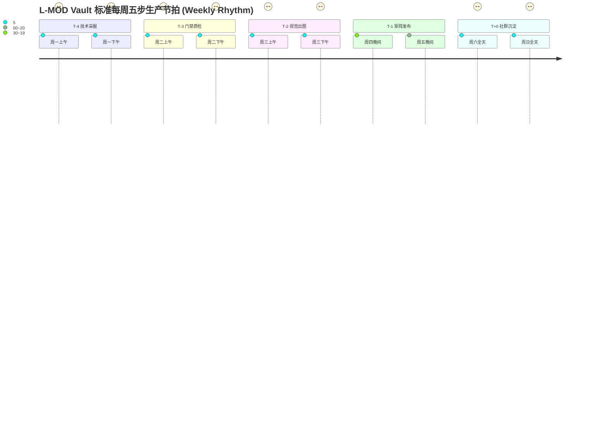

# L-MOD Vault 旗舰游戏周排期时间线矩阵与生产管理看板 (Milestone 3)

> **版本**：v3.0 (Milestone 3 落地版)  
> **制定周期**：2026年第四季度 (覆盖 Rank 5 ~ Rank 10 核心大作)  
> **生产原则**：以周为单位稳定推进 · 每周攻坚 1 款旗舰大作深度全息数据 + 3~4 组自媒体物料 · 双重门禁强制把关。

---

## 📅 一、量化周节奏排期日历 (Weekly Cadence Timeline)

为了确保工业级质量交付与自媒体矩阵的持续曝光，设立严格的**周一至周日标准化节拍**：



### 每日工时与交付物对账表

| 星期 | 作业节点 | 核心任务与工时分配 | 每日强制交付物标准 | 责任角色 |
|---|---|---|---|---|
| **周一** | **T-4 技术采掘** | • 上午 (3h)：四级深度检索，锁定官方当前版本前置框架<br>• 下午 (4h)：8大系统维度逐项对账，提炼真实可执行代码 | 生成包含 8 大分类、≥40 条真实指令、FLiNG 配置与 4 款精选 Mod 的结构化数据 | 逆向数据工程师 |
| **周二** | **T-3 门禁质检** | • 上午 (2h)：运行 `validate_game.py` 强类型静态排查<br>• 下午 (3h)：运行 `audit_game_data.py` 引擎语法 Linter | 运行 `pipeline_gate.py`，T-4 与 T-3 双双输出 `🟢 [PASS]` 绿色通过 | 自动化门禁测试员 |
| **周三** | **T-2 视觉出图** | • 上午 (2h)：通过脱敏词典生成小红书/B站多平台文案<br>• 下午 (4h)：运行出图引擎，批量导出 1080x1440 5联图 | `social_distribution/` 下生成 5 张高清 PNG 卡片与文案 Markdown 包 | 视觉包装与内容架构师 |
| **周四** | **T-1 首发预热** | • 晚间 (18:30-19:30)：小红书发布图文笔记，埋设三级标签<br>• 发布后 5 分钟内：首评置顶答疑话术与暗号植入 | 公域笔记正式上线，首评置顶成功，监控前 2 小时曝光与点赞数据 | 社交矩阵运营官 |
| **周五** | **T-1 矩阵跟进** | • 晚间 (19:00-20:30)：B站发布动态长图与深度专栏长文<br>• 同步更新知乎相关高权重游戏提问 | B站与知乎长效阵地发布完成，私域暗号自动推送通道核验畅通 | 社交矩阵运营官 |
| **周六** | **T+0 社群沉淀** | • 全天监控：解答评论区快捷键冲突、按键没反应、闪退问题<br>• 承接公众号与玩家交流圈私域流量 | 形成玩家高频问题解答台账，私域用户转化入库 | 社群增长管家 |
| **周日** | **T+0 雷达与复盘** | • 巡检 Steam 官方补丁公告与 SteamDB 变动<br>• 下周顺位大作技术预采掘与工具包预下载 | 输出本周矩阵分发数据复盘报告，完成下周预备立项 | 项目总控负责人 |

---

## 📊 二、Rank 5 ~ Rank 10 核心大作排期总表

| 顺位 | 游戏名称 | 引擎与前置技术栈 | 排期周次 | 目标发布日 | T-4 采掘 | T-3 质检 | T-2 出图 | T-1 发布 | 当前工程状态与资产指标 |
|---|---|---|---|---|---|---|---|---|---|
| **Rank 5** | **艾尔登法环 (Elden Ring)** | FromSoftware Dantelion<br>ModEngine2 / TGA CT 表 | **Week 1** | 2026-10-24 | 🟢 完成 | 🟢 通过 | 🟡 进行中 | ⏳ 排期中 | 8 大类 / 41 条指令 / 4 Mods<br>黄金树幽影 DLC 庇护拉满、EAC 离线防封 |
| **Rank 6** | **上古卷轴5：天际重制版 (Skyrim SE/AE)** | Creation Engine 1<br>SKSE64 / SSE Engine Fixes | **Week 2** | 2026-10-31 | 🟢 完成 | 🟢 通过 | 🔵 待出图 | ⚪ 规划中 | 8 大类 / 41 条指令 / 4 Mods<br>CTD 闪退急救、恶性任务 setstage、16魔神器 |
| **Rank 7** | **辐射4：次世代更新版 (Fallout 4 NG)** | Creation Engine 1<br>F4SE Next-Gen / bat 批处理 | **Week 3** | 2026-11-07 | 🟢 完成 | 🟢 通过 | 🔵 待出图 | ⚪ 规划中 | 8 大类 / 42 条指令 / 4 Mods<br>次世代避坑与降级、聚落空间无限、双弹爆破附魔 |
| **Rank 8** | **幻兽帕鲁 (Palworld)** | Unreal Engine 5<br>RE-UE4SS / Palworld Save Tools | **Week 4** | 2026-11-14 | ⏳ 队列中 | ⚪ 等待中 | ⚪ 等待中 | ⚪ 规划中 | 2 大类 / 6 条指令 / 2 Mods<br>待深度采掘：神兽词条基因注入、据点帕鲁上限 |
| **Rank 9** | **星空 (Starfield)** | Creation Engine 2<br>SFSE / Baka Achievement Enabler | **Week 5** | 2026-11-21 | ⏳ 队列中 | ⚪ 等待中 | ⚪ 等待中 | ⚪ 规划中 | 3 大类 / 11 条指令 / 3 Mods<br>待深度采掘：全归一星裔圣殿神力、造船无限预算 |
| **Rank 10** | **侠盗猎车手 5 (Grand Theft Auto V)** | Rockstar RAGE Engine<br>Script Hook V / 原生秘籍 | **Week 6** | 2026-11-28 | ⏳ 队列中 | ⚪ 等待中 | ⚪ 等待中 | ⚪ 规划中 | 2 大类 / 6 条指令 / 3 Mods<br>待深度采掘：绝版载具刷出、通缉星级消除、股市拉满 |

---

## 🛠️ 三、自动化排期跟踪管理工具使用指南

系统内置了自动化跟踪命令行工具 `scripts/schedule_tracker.py`，项目成员与自动化流水线可通过命令行直接调用：

```bash
# 1. 查看 Rank 5 ~ Rank 10 生产排期总览看板
python3 scripts/schedule_tracker.py list

# 2. 查询指定游戏的详细全息档案与流水线节点
python3 scripts/schedule_tracker.py status elden-ring
python3 scripts/schedule_tracker.py status skyrim-se
python3 scripts/schedule_tracker.py status fallout-4

# 3. 推进指定游戏的阶段状态 (例如将 elden-ring 的 T-2 视觉出图标记为完成)
python3 scripts/schedule_tracker.py advance elden-ring T-2 COMPLETED

# 4. 生成当前 Milestone 3 生产健康度与就绪度综合报告
python3 scripts/schedule_tracker.py report
```

---

## 🛡️ 四、阶段流转硬性阻断与门禁规则

1. **红线一 (未经双严门禁绝不允许出图)**：
   必须通过 `validate_game.py` 强类型静态校验与 `audit_game_data.py` 引擎语法 Linter（必须双 `[PASS]`），方可调用 `generate_social_matrix.py` 与出图引擎。任何一条未通过均自动阻断流程。
2. **红线二 (未经合规脱敏绝不允许发布)**：
   所有输出给前端展示与自媒体平台分发的文案，必须通过脱敏词典扫描，严禁出现“作弊”、“外挂”、“修改器”、“破解”、“刷钱”等平台封禁词。
3. **红线三 (官方更新未经验证绝不盲目发新版)**：
   Steam 官方推送更新后，若框架发生偏移失效，优先引导玩家使用老L一键包内的还原脚本或降级补丁，并在置顶评论同步雷达说明，严禁发布未经本地实操验证的第三方失效工具。
