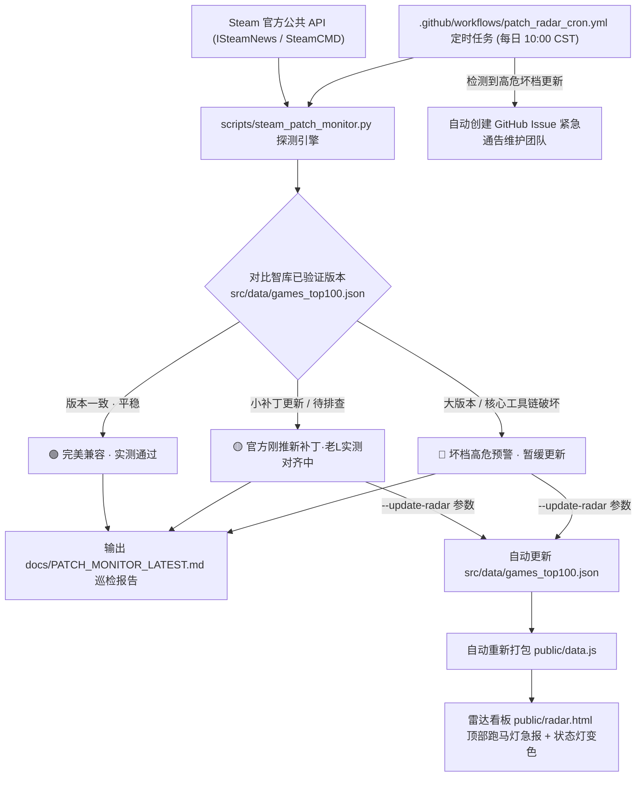

# 📡 L-MOD Vault Steam 补丁自动化巡检机器人与避坑预警系统操作指南

> **文档版本**：`v3.0 (Final Milestone 3)`  
> **适用模块**：Steam 补丁变动自动化巡检脚本 (`scripts/steam_patch_monitor.py`) ｜ 避坑雷达看板 (`public/radar.html`) ｜ 定时巡检流水线 (`.github/workflows/patch_radar_cron.yml`)

---

## 📌 一、系统设计与整体架构

为了解决单机游戏 Steam 官方突发更新导致旧版 Mod / 控制台注入前置大面积失效并损坏玩家存档的问题，L-MOD Vault 研发了**全自动化 Steam 补丁巡检哨兵机器人**。



---

## 🎮 二、Top 14 旗舰大作 Steam AppID 映射表

| Rank | 游戏大作 (Title) | Steam AppID | 底层引擎 | 核心工具链 | 智库认证基准版本 | 高危敏感度 |
|:---:|:---|:---:|:---|:---|:---|:---:|
| #1 | **Cyberpunk 2077** | `1091500` | REDengine 4 | CET v1.33.0 / REDmod | Patch 2.13 (往日之影全兼容) | 🔴 高危 (CET/REDscript) |
| #2 | **Black Myth: Wukong** | `2358720` | 虚幻引擎 5 (UE5) | UE4SS v3.0.1+ / 原生控制台 | v1.0.10.15610 实测通过 | 🟡 中度 (Pak 模式较稳) |
| #3 | **The Witcher 3: Wild Hunt** | `292030` | REDengine 3 | REDkit / Script Merger | v4.04 (次世代完全版) | 🟡 中度 (脚本合并冲突) |
| #4 | **Baldur's Gate 3** | `1086940` | Divinity Engine 4.0 | BG3SE v18+ / 原生加载器 | Patch 7 (官方工坊对齐) | 🔴 高危 (BG3SE 内存挂钩) |
| #5 | **Elden Ring** | `1245620` | FromSoft 自研 | ModEngine2 / EAC 管道拦截 | v1.14 (黄金树幽影完全对齐) | 🔴 高危 (EAC 偏移易封号) |
| #6 | **Skyrim SE** | `489830` | Creation Engine 1 | SKSE64 2.2.6 / Address Lib | v1.6.1170 (SE/AE 深度适配) | 🔴 高危 (SKSE 强锁版本) |
| #7 | **Fallout 4** | `377160` | Creation Engine 1 | F4SE NG / Downgrader | v1.10.984+ (次世代双轨) | 🔴 高危 (次世代毁生态) |
| #8 | **Palworld** | `1623730` | 虚幻引擎 5 (UE5) | UE4SS-RE / Palworld Mod Kit | v0.3.x (樱岛版本完全对齐) | 🟢 低危 (UE4SS 容错好) |
| #9 | **Starfield** | `1716740` | Creation Engine 2 | SFSE / StarfieldCustom.ini | v1.14 (破碎空间DLC完全对齐) | 🔴 高危 (SFSE 脚本扩展) |
| #10 | **Grand Theft Auto V** | `271590` | RAGE 引擎 | ScriptHookV / OpenIV | v1.0.3179 (线上DLC完全对齐) | 🔴 高危 (BattlEye 封号) |
| #11 | **Red Dead Redemption 2** | `1174180` | RAGE 引擎 | ScriptHookRDR2 / LML | v1.0.1491 (完全对齐) | 🔴 高危 (ScriptHook 锁版本) |
| #12 | **Monster Hunter: World** | `582010` | MT Framework | Stracker's Loader / REFramework | v15.11 (冰原最终版完全对齐) | 🟢 低危 (已彻底封包) |
| #13 | **Sekiro: Shadows Die Twice** | `814380` | FromSoft 自研 | Mod Engine / Dinput8 Hook | v1.06 (年度版完全对齐) | 🟢 低危 (终身锁定版本) |
| #14 | **Resident Evil 4 Remake** | `2050650` | RE Engine | REFramework / Fluffy Mod | v1.0+ (逆命殊途DLC完全对齐) | 🔴 高危 (Enigma/REFramework) |

---

## 🛠️ 三、脚本命令行使用手册

脚本位于 `scripts/steam_patch_monitor.py`，纯 Python 标准库开发，零第三方 pip 依赖。

### 1. 基础快速巡检 (Top 14 旗舰大作)
```bash
python3 scripts/steam_patch_monitor.py
```
- 控制台实时输出当前 14 款重点大作的探测进度与版本状态；
- 自动生成结构化对账报告：`docs/PATCH_MONITOR_LATEST.md`。

### 2. 联动同步雷达看板 (`--update-radar`)
```bash
python3 scripts/steam_patch_monitor.py --update-radar
```
- 自动将检测到的新版本动态与广播写入 `src/data/games_top100.json`；
- 自动重新打包生成 `public/data.js`；
- 打开 `public/radar.html`，顶部跑马灯与各游戏状态灯将实时联动。

### 3. 单款游戏精准检测 (`--game` 或 `--appid`)
```bash
# 按游戏 ID 检测
python3 scripts/steam_patch_monitor.py --game cyberpunk-2077

# 按 Steam AppID 检测
python3 scripts/steam_patch_monitor.py --appid 1086940
```

### 4. 突发更新实战模拟演练 (`--simulate-patch`)
模拟官方突然推送大更新的紧急预警全流程：
```bash
python3 scripts/steam_patch_monitor.py \
  --simulate-patch cyberpunk-2077 \
  --simulate-version "Update 2.5 (Edgerunners 2)" \
  --simulate-risk red \
  --update-radar
```
- 此时 `public/radar.html` 顶部跑马灯将亮起红灯：`🔴【Cyberpunk 2077】Steam 刚刚推送 Update 2.5 (Edgerunners 2)！核心前置可能失效，高危坏档！请开启离线模式暂缓更新！`；
- 赛博朋克2077 卡片变红带脉冲动效，抽屉展示紧急避坑指南。

---

## 🤖 四、GitHub Actions 无人值守自动化配置

工作流定义位于 `.github/workflows/patch_radar_cron.yml`。

### 1. 定时触发机制
- **Cron 设定**：`0 2 * * *`（UTC 02:00，对应北京时间每天上午 10:00）；
- **工作机制**：
  1. 虚拟机定时启动，检出仓库最新代码；
  2. 执行 `python3 scripts/steam_patch_monitor.py --update-radar`；
  3. 执行 `python3 scripts/verify_i18n_dual_pages.py` 双页与多语言门禁自检；
  4. 若发现 Steam 发生了版本变动，自动提交代码到 Git 并 Push；
  5. 若检测到 `🔴【坏档高危·暂停更新】`，自动创建带有完整避坑报告的 GitHub Issue，通知维护者。

### 2. 手动一键调度 (workflow_dispatch)
在 GitHub 仓库页面点击 **Actions** -> **Steam Patch Sentinel Cron** -> **Run workflow**：
- 可选填 `simulate_game`、`simulate_version` 即可随时发起演练测试。

---

## 📢 五、社群与社媒应急话术模版

每次巡检输出的 `docs/PATCH_MONITOR_LATEST.md` 末尾已内置一键复制模版：

### 💬 微信/QQ 避坑互助群公告
```text
🚨【老L避坑警报】《{游戏名称}》刚刚推送官方更新！
⚠️ 风险等级：🔴 坏档预警·暂缓更新
📌 最新更新标题：{补丁名称}
🔍 智库认证版本：{已验证版本}
--------------------------------------------------
🔒 紧急避坑操作提示：
1. 请大家务必先暂停 Steam 自动更新（游戏属性 -> 更新 -> 仅在启动时更新）！
2. 严禁直接载入带有高阶 Mod 的老存档，极易引发脚本断裂或坏档卡死！
3. 建议直接在 Steam 离线模式下运行游戏；
4. 老L实验室已启动真机实机排查，免坏档兼容整合包稍后推送！
--------------------------------------------------
📡 实时避坑雷达看板：https://l-mod.pages.dev/radar.html
```

---

## 🛡️ 六、门禁自检与验收

每次修改雷达或巡检脚本后，务必执行项目终极质检门禁：
```bash
python3 scripts/verify_i18n_dual_pages.py
```
确保 8 大语言（zh-CN, en, zh-TW, ja, ko, ru, de, es）250+ 键位 100% 对称，DOM 挂载零缺失。
