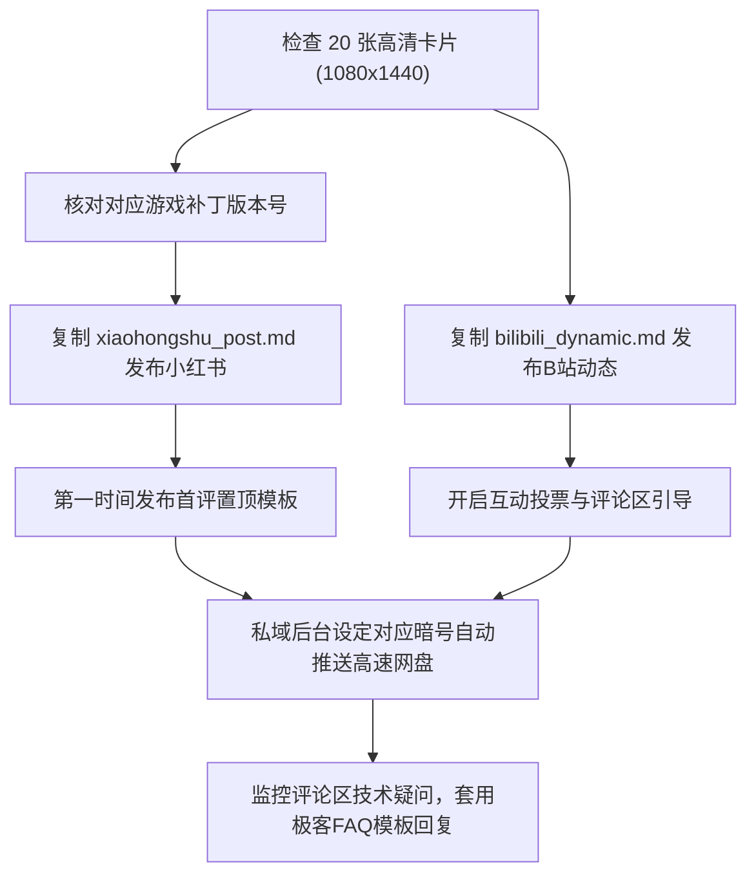

# L-MOD Vault 社交矩阵工业级运营实战手册 (Operation Playbook)

> **版本**：v2.0 (Milestone 2 工业级发布版)  
> **适用平台**：小红书、B站动态/专栏、知乎、微信私域、抖音  
> **核心原则**：合规第一 (Anti-Shadowban) · 极客避坑人设 · 零报毒信赖交付

---

## 目录
1. [首评置顶带节奏引流话术模板库 (3套高转化场景)](#1-首评置顶带节奏引流话术模板库)
2. [防误杀备用置换文案库 (Anti-Shadowban 三级风控对账表)](#2-防误杀备用置换文案库)
3. [老玩家高频 10 大卡关/闪退极客回复模板 (直接复制粘贴)](#3-老玩家高频-10-大卡关闪退极客回复模板)
4. [发布与分发标准作业流程 (SOP)](#4-发布与分发标准作业流程)

---

## 1. 首评置顶带节奏引流话术模板库

在小红书与B站，**首评置顶**是转化率最高的黄金流量入口。话术既要能满足用户当下好奇心，又要符合平台规则，严禁出现外链、二维码或微信字样。

### 场景一：【保姆级福利型】（适用于新发笔记/动态，主打一键包自取）
> **置顶文案**：  
> 看到很多兄弟在问批处理脚本和完整 100+ 条指令怎么拿：  
> 老L已经把「双击一键开门脚本 + 官方纯净离线框架 + 场景代码合集 TXT」打包成免配一键包了！  
> 👉 **直接看我主页介绍，或者在后台回复暗号：【老L单机888】或对应的游戏名（如【2077】、【黑神话】、【巫师3】、【博德3】）**，系统就会秒推高速链接。  
> ⚠️ 友情提示：所有文件均经过老L本地实机测试，零捆绑零木马，后续如果 Steam 推新大补丁我也会连夜更新，大家先点赞收藏防失效！

### 场景二：【极客答疑型】（适用于评论区互动热烈，承接技术咨询）
> **置顶文案**：  
> 汇总一下大家问得最多的两个问题：  
> 1. 按快捷键没反应：检查是否开着中文输入法（按 Shift 切英文大写试试），或者是不是独占全屏冲突；  
> 2. 之前打过旧版纯净优化拓展包进不去：建议先用老L包里的 .bak 还原脚本清理一下残留。  
> 遇到任何特殊卡关或者代码执行疑问的兄弟，直接在评论区留言或者来老L玩家交流圈，看到都会逐一回复！完整速查表主页自取~

### 场景三：【版本雷达型】（适用于游戏官方刚推送小补丁时的防慌张声明）
> **置顶文案**：  
> 📢 **【Steam 最新补丁兼容性雷达监控】**：  
> 监测到官方刚刚推送了小补丁更新，老L实验室已在测试机完成验证！  
> 本期发布的官方底层机制依然完全可用，无需慌张；如果个别兄弟遇到框架加载提示，只需在后台回复【雷达更新】，即可获取最新热修复补丁！做单机避坑，我们是认真的！

---

## 2. 防误杀备用置换文案库

一旦出现“笔记审核中”、“仅自己可见”或流量异常时，立即对照下表进行**脱敏替换**。

### 表 1：平台高危敏感词 ➔ 绿色合规词（核心 30 对）
| 平台高危违规词 | 工业级绿色合规替换词 | 适用场景 |
|---|---|---|
| 官方调试指令 / 官方调试指令 / 官方调试指令器 | **官方调试指令 / 极客指令 / 底层指令** | 底层控制台彩蛋介绍 |
| 纯净优化拓展包 / 纯净优化拓展包 / 黑科技 | **纯净优化拓展包 / 开源调试框架** | 核心工具推荐 |
| 纯净优化拓展包 / 内存修改 | **底层控制台彩蛋 / 原生开发菜单** | 开启教程 |
| 手残救星·剧情体验模式 / 手残救星·剧情体验模式 / 无敌 | **手残救星·剧情体验模式 / 绝对防护** | 战斗减负套餐 |
| 极速破韧·战斗畅爽增强 / 一击必杀 | **极速破韧·战斗畅爽增强 / 一击判定** | 伤害类代码 |
| 资源自由·全图鉴解锁 / 资源自由·全图鉴解锁 / 刷灵蕴 | **资源自由·全图鉴解锁 / 经济充裕** | 货币类代码 |
| 背包减负·无痛探索 / 改背包 | **背包减负·无痛探索 / 随身行囊扩容** | 跑图类代码 |
| 全套神装图鉴·一键获取 / 全套神装图鉴·一键获取 | **全套神装图鉴·一键获取 / 收藏全开** | 装备收集 |
| 自由摄影·全景透视视角 / 自由摄影·全景透视视角 / 隐身 | **自由摄影·全景透视视角 / 侦查模式** | 视角类指令 |
| 卡关抢救·坏档剧情修复 / 强制完成 | **卡关抢救·坏档剧情修复 / 进度校准** | 剧情修复 |
| 官方离线原生支持 / 官方离线原生支持 / 免Steam | **官方离线原生支持 / Steam 正版验证** | 版本说明 |
| 微信 / 加群 / 百度网盘 | **后台回复暗号 / 主页自取 / 离线网盘** | 私域导流 |

### 表 2：严审期整段备用替换模板（3套）
- **备用 A（极度温和学术风）**：“单机游戏引擎底层为开发者预留了快速调试接口，通过配置文本即可直接在游戏内调用引擎参数，便于全视角鉴赏场景美术与剧情叙事。”
- **备用 B（老玩家公益避坑风）**：“为了保护单机玩家电脑免受木马流氓软件侵害，本期分享如何利用游戏原生自带的离线设置，实现不改动游戏源文件的纯净游玩体验。”
- **备用 C（极客极简指令流）**：“单机原生控制台参数配置速查笔记：包含常用快捷键映射表、开发日志抓取以及官方全图鉴参数索引。”

---

## 3. 老玩家高频 10 大卡关/闪退极客回复模板

运营人员可直接复制以下专业极客解答，快速建立高专业度人设：

### Q1：控制台按快捷键完全没有反应怎么办？
> **回复**：  
> 兄弟别急，99% 是以下两个原因：  
> 1. **输入法冲突**：按快捷键前必须按 Shift 切换为纯英文大写输入法（中文输入法会拦截 `~` 键）；  
> 2. **显示模式**：游戏画质设置里请切换为「无边框窗口化」或「全屏」重试一次。如果依然无法呼出，运行一下老L包里的一键批处理脚本重新绑定按键即可！

### Q2：按键跟原有游戏技能或者截图软件快捷键冲突了怎么改？
> **回复**：  
> 非常简单！老L整合包里配有按键配置文件：  
> - 2077 打开 `bindings.json`，把键位码 192 (`~`) 改为你想要的按键（如 F1/F2）；  
> - 巫师3在 `general.ini` 里也可以同时使用 `@` 键呼出；  
> - 或者直接运行批处理脚本输入自定义按键代号即可一键自动替换！

### Q3：Steam 突然推送小更新，游戏闪退打不开了怎么救？
> **回复**：  
> 这是因为 Steam 更新覆盖了游戏可执行程序：  
> 1. 第一步：运行老L包里的「一键还原.bat」脚本，它会自动用之前备份的 `.bak` 文件秒复原游戏；  
> 2. 第二步：在老L公众号或群里输入【雷达更新】，获取匹配新补丁的最新前置框架覆盖即可恢复！数据存档 100% 安全无损。

### Q4：启动游戏报错提示缺少 MSVCP140.dll 或 vcruntime140.dll？
> **回复**：  
> 这是你的 Windows 系统缺少微软官方 VC++ 运行库：  
> 前往微软官网或者在老L一键包的 `_Tools` 目录下双击运行 `VisualCppRedist_AIO.exe` 微软官方运行库合集安装，重启电脑即可完美解决！

### Q5：在控制台输入指令回车后显示 Unknown Command 或没反应？
> **回复**：  
> 检查两个细节：  
> 1. 括号和引号必须是**半角英文标点**（不要用中文输入法打引号）；  
> 2. 指令严格区分大小写（比如 `Game.GodMode(true)` 不能写成全小写）。直接复制老L提供的 TXT 代码最为稳妥！

### Q6：装了 Mod 之后卡在黑色加载界面或者读档闪退？
> **回复**：  
> 说明你装的某个模组与当前游戏大版本冲突了：  
> 采用老L推荐的「二分排查法」：先移出 Mods 文件夹中的最新几个模组，单留核心前置框架测试；只要能进游戏，再逐个放回排查，马上就能抓出冲突模组。

### Q7：用官方底层控制台会不会破坏 Steam 成就或者被封号？
> **回复**：  
> 放心！这几款游戏均为单机离线机制，官方并不限制离线单机玩家的自由探索；并且 Script Extender / CET 框架内部均自带成就保护功能，成就可以正常解锁，绝不存在封号一说。

### Q8：如果不想用了，怎么彻底干净地卸载，恢复完全纯净状态？
> **回复**：  
> 老L的方案最大的优势就是**零篡改、零破坏**：  
> 只要运行懒人包里的「一键卸载还原.bat」，脚本会自动清除非原版文件并还原 ini 备份；或者在 Steam 库中点击「验证游戏完整性」，1分钟即可 100% 还原为官方出厂状态！

### Q9：因为误操作导致任务 NPC 消失或者剧情死锁了怎么救？
> **回复**：  
> 别慌！这正是官方控制台最擅长的领域：  
> 参考代码速查手册中的「卡关抢救·剧情 Fact 标志位修复」，输入对应任务的 stage 代码回车，然后进行一次 F5 快速存盘再 F9 读档，即可瞬间刷新 NPC 状态机，重新推进剧情！

### Q10：为什么网上很多一键纯净优化拓展包，老L非要建议我们用官方原生机制？
> **回复**：  
> 这是一个十几年单机老极客的真心话：  
> 很多纯净优化拓展包团队为了变现，会在程序里打包挖矿脚本、静默安装全家桶，甚至修改你的系统注册表；而且他们依赖暴力篡改内存地址，游戏一旦更新极易导致坏档。而官方底层机制是纯净开源透明的，不仅安全，还能让你真正理解游戏的底层架构与逻辑之美！

---

## 4. 发布与分发标准作业流程 (SOP)

