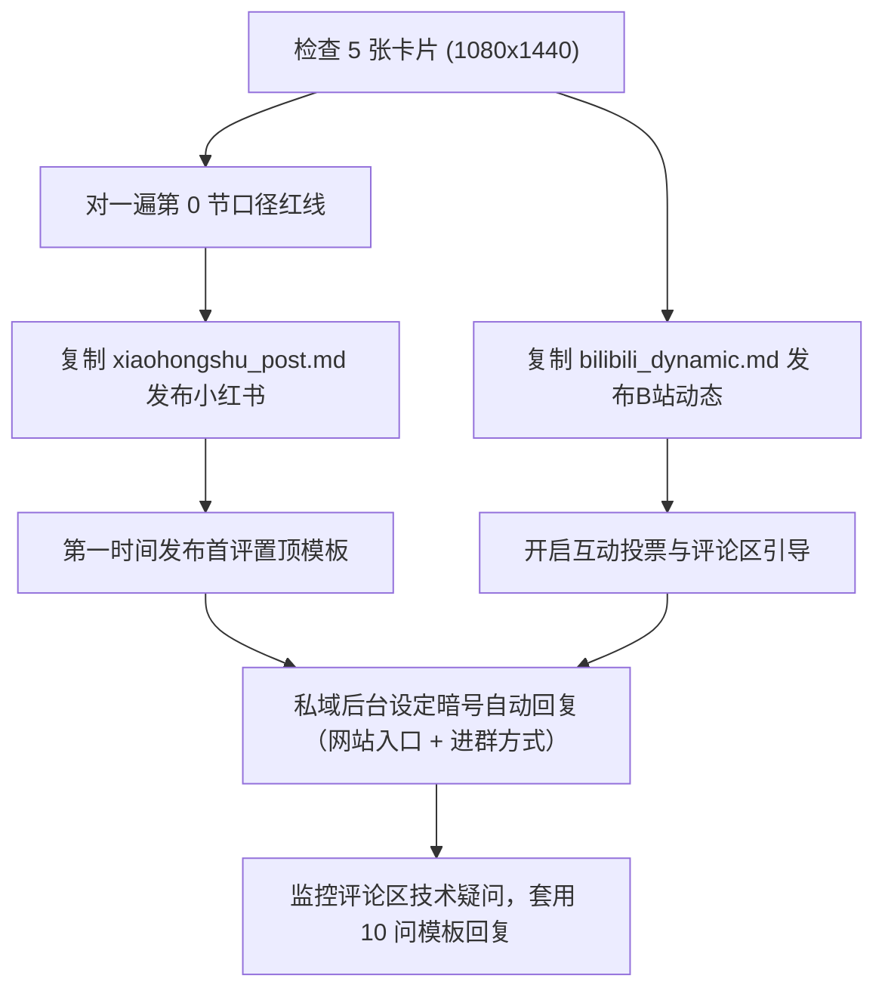

# L-MOD Vault 社交平台运营手册 (Operation Playbook)

> **适用平台**：小红书、B站动态/专栏、知乎、微信私域、抖音
> **核心原则**：只写做到的事 · 极客避坑人设 · 不留外链

---

## 目录
0. [口径红线（发之前先对一遍）](#0-口径红线发之前先对一遍)
1. [首评置顶话术模板 (3 套)](#1-首评置顶话术模板)
2. [平台用词替换表](#2-平台用词替换表)
3. [玩家高频 10 问回复模板](#3-玩家高频-10-问回复模板)
4. [发布与分发标准作业流程 (SOP)](#4-发布与分发标准作业流程)

---

## 0. 口径红线（发之前先对一遍）

| 别这么说 | 事实 | 可以这么说 |
|---|---|---|
| 实测 / 亲测 / 已校验 / 认证 / 对齐最新补丁 | 没有人逐条在游戏里试过这些指令和 Mod | 老L整理 · 没有逐条实测 · 用前先存档 |
| 自动备份 / 一键还原 / .bak 秒复原 / 存档 100% 安全 | 7 款里只有 2077 / 黑神话 / 巫师3 / 博德3 的 .bat 改配置前另存 .bak；法环 / 老滚5 / 辐射4 的 .bat 只检查目录、打印提示；**所有脚本都不备份存档**；没有「一键还原 / 一键卸载」脚本 | 操作前先手动备份存档；想还原就删掉放进去的文件，再在 Steam 里验证游戏文件完整性 |
| 后台秒推网盘 / 懒人包 / 离线框架包 / 100+ 条速查手册 | 没有网盘包；资料都在 L-MOD Vault 网站对应游戏页 | 脚本和指令在网站本游戏页，免费看 |
| 连夜更新 / 第一时间测试 / 测试机验证 / 热修复补丁 | 没有测试机；避坑雷达每天比对一次 Steam 更新时间，不做实机测试 | 更新情况看避坑雷达；框架可能要等作者发新版 |
| 零封号 / 零闪退 / 零报毒 / 100% 安全 | 谁也保证不了 | 只在单机 / 离线下用，别带进联机 |
| 官方控制台（指 CET / UE4SS / Script Extender） | 这些是社区开源框架，不是官方的；巫师3 / 老滚5 / 辐射4 的控制台才是游戏自带 | 开源框架 · 源码公开 / 游戏自带控制台 |

---

## 1. 首评置顶话术模板

在小红书与B站，**首评置顶**是转化率最高的入口。话术既要满足好奇心，又要符合平台规则，严禁出现外链、二维码或微信字样。

### 场景一：【资料自取型】（新发笔记/动态，主打去网站看）
> **置顶文案**：
> 看到很多兄弟在问 .bat 脚本和完整指令在哪：
> 都在 L-MOD Vault 网站对应游戏页，免费看，.bat 是纯文本，可用记事本查看全部内容。
> 👉 **网站入口见我主页介绍；想进玩家互助群交流，在后台发送暗号：【老L单机888】或对应的游戏名（如【2077】、【黑神话】、【巫师3】、【博德3】）**。
> ⚠️ 指令没有逐条实测，用之前先手动备份存档；游戏更新后可能要等作者适配，更新情况看避坑雷达。

### 场景二：【答疑型】（评论区互动热烈，承接技术咨询）
> **置顶文案**：
> 汇总一下大家问得最多的两个问题：
> 1. 按快捷键没反应：检查是否开着中文输入法（按 Shift 切英文试试），或者是不是独占全屏冲突；
> 2. 之前装过别的修改器进不去：先把那些文件删掉，再在 Steam 里验证游戏文件完整性。
> 遇到特殊卡关或者指令执行疑问的兄弟，直接在评论区留言或者来玩家互助群，看到会回复！完整指令在网站本游戏页~

### 场景三：【版本提醒型】（游戏刚推送更新时）
> **置顶文案**：
> 📢 **【Steam 更新提醒】**：
> 这款游戏刚推了更新，L-MOD Vault 避坑雷达已经标出来了。
> 按 exe 版本挂钩的框架（CET / UE4SS / Script Extender / F4SE 等）可能要等作者发新版，着急的话先别更新；游戏自带的控制台一般不受框架影响。
> 已经更新、框架用不了的话：先把框架文件移出游戏目录玩原版，等作者发新版再装回去。

---

## 2. 平台用词替换表

笔记出现“审核中”“仅自己可见”或流量异常时，对照下表换说法。**只换说法，别换出没做过的承诺**（比如别把「破解」换成「官方离线原生支持」，别把「修改器」换成「纯净××」）。

### 表 1：平台敏感词 ➔ 中性说法
| 平台敏感词 | 中性说法 | 适用场景 |
|---|---|---|
| 作弊 / 作弊码 / 作弊器 | **调试指令 / 控制台指令** | 控制台代码介绍 |
| 外挂 / 辅助挂 / 黑科技 | **第三方工具 / 开源框架** | 核心工具推荐 |
| 修改器 / 内存修改 | **第三方工具 / 控制台** | 开启教程 |
| 锁血 / 无限血 / 无敌 | **手残救星·剧情体验模式** | 战斗减负套餐 |
| 秒杀 / 一击必杀 | **极速破韧·战斗畅爽增强** | 伤害类代码 |
| 刷钱 / 无限金币 / 刷灵蕴 | **资源自由·全图鉴解锁** | 货币类代码 |
| 无限负重 / 改背包 | **背包减负·无痛探索** | 跑图类代码 |
| 全武器解锁 / 刷物品 | **全套神装图鉴·一键获取** | 装备收集 |
| 穿墙 / 飞天 / 隐身 | **自由摄影·全景透视视角** | 视角类指令 |
| 跳过任务 / 强制完成 | **卡关抢救·推进任务进度** | 剧情卡关 |
| 破解 / 盗版 / 免Steam | **来路不明的版本**（我们只讲 Steam 正版） | 版本说明 |
| 微信 / 加群 / 百度网盘 | **后台发送暗号 / 主页介绍** | 私域导流 |

### 表 2：严审期整段备用模板（3套）
- **备用 A（温和学术风）**：“不少单机游戏保留了开发用的控制台，通过配置文本即可在游戏内调用，便于鉴赏场景美术与剧情叙事。”
- **备用 B（老玩家公益避坑风）**：“为了少碰来路不明的软件，本期分享如何用游戏自带的控制台或开源框架，在单机模式下调整游戏体验。”
- **备用 C（极简指令流）**：“单机控制台参数配置速查笔记：常用快捷键映射表与指令索引。”

---

## 3. 玩家高频 10 问回复模板

运营人员可直接复制以下回复：

### Q1：控制台按快捷键完全没有反应怎么办？
> **回复**：
> 兄弟别急，常见是这两个原因：
> 1. **输入法冲突**：按快捷键前先按 Shift 切成英文（中文输入法会拦截 `~` 键）；
> 2. **显示模式**：画面设置里切换为「无边框窗口化」或「全屏」再试一次。还不行的话，对照网站本游戏页检查框架文件是不是放对了目录。

### Q2：按键跟原有游戏技能或者截图软件快捷键冲突了怎么改？
> **回复**：
> - 2077：CET 第一次启动会让你选按键，之后也可以在 CET 的设置里改；
> - 巫师3：`general.ini` 打开控制台后，`~` 和 `@` 都能呼出；
> - 其他游戏：看对应框架的配置文件或说明页。

### Q3：Steam 突然推送更新，游戏闪退打不开了怎么办？
> **回复**：
> 大概率是按 exe 版本挂钩的框架（CET / UE4SS / Script Extender / F4SE 等）还没适配新版本：
> 1. 先把框架文件移出游戏目录，原版一般就能正常启动；
> 2. 等框架作者发新版再装回去，进度可以看 L-MOD Vault 避坑雷达；
> 3. 存档不会被自动备份，下次装框架、改配置之前，先手动复制一份存档文件夹。

### Q4：启动游戏报错提示缺少 MSVCP140.dll 或 vcruntime140.dll？
> **回复**：
> 这是 Windows 缺少微软 VC++ 运行库：去微软官网下载安装 Visual C++ Redistributable（x64），装完重启电脑再试。

### Q5：在控制台输入指令回车后显示 Unknown Command 或没反应？
> **回复**：
> 检查两个细节：
> 1. 括号和引号必须是**半角英文标点**（不要用中文输入法打引号）；
> 2. 有些指令区分大小写（比如 `Game.GodMode(true)` 不能写成全小写）。从网站本游戏页直接复制最稳妥。
> 指令没有逐条实测，版本不同也可能失效。

### Q6：装了 Mod 之后卡在黑色加载界面或者读档闪退？
> **回复**：
> 多半是某个模组和当前游戏版本冲突了：
> 用「二分排查法」：先移出 Mods 文件夹里最新装的几个模组，只留核心前置框架测试；能进游戏了，再逐个放回去，就能找出冲突的那个。

### Q7：用控制台 / Mod 会不会影响 Steam 成就，会不会被封号？
> **回复**：
> 说实话，这个没法打包票：
> - 成就：各游戏不一样，有的装 Mod 后会关掉成就（比如 B 社游戏装插件后），想刷成就的先别装；
> - 封号：只在单机 / 离线下用；像艾尔登法环这种有联机的游戏，别把改过的存档带上线。

### Q8：不想用了，怎么恢复干净的原版？
> **回复**：
> 1. 删掉自己放进游戏目录的框架和 Mod 文件；改过的配置文件如果脚本留了 `.bak`，把它改回原名；
> 2. 在 Steam 库里右键游戏 ➔ 属性 ➔ 已安装文件 ➔ 验证游戏文件完整性，会把被改动或缺失的原版文件补回来（多出来的文件它不删，所以第 1 步要自己做）；
> 3. 存档不在这个范围里，验证不会动它，也不会帮你恢复。

### Q9：因为误操作导致任务 NPC 消失或者剧情死锁了怎么救？
> **回复**：
> 先存档，再试试控制台：
> 查一下对应任务的 ID 和阶段，用 setstage 推进到下一阶段，然后存档、读档看看 NPC 有没有恢复。不是每个任务都管用，阶段填错也可能把任务弄乱，所以一定先留一个存档。

### Q10：为什么不推荐网上的一键修改器？
> **回复**：
> 一个老单机玩家的真心话：
> 来路不明的修改器有的会捆绑弹窗或后门；而且按内存地址改数据，游戏一更新就容易失效甚至坏档。游戏自带的控制台和开源框架，代码来源更清楚，出了问题也好查。

---

## 4. 发布与分发标准作业流程 (SOP)

